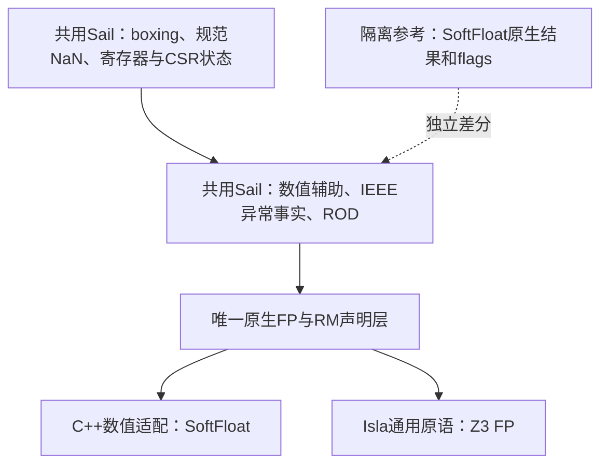

# 共用 Sail 浮点语义与双后端计划

日期：2026-09-27。当前状态：共用Sail模型、C++原生FP/RM lowering与190声明适配已经实现；67个helper的列定三方比较与来源绑定通过。56cc候选的完整接线、初始化及18,584个历史输入的双后端AST/ret/102字段重放已独审通过；strict迁移的129个保留region中127实际非空、2处历史为空，不能称129全有效。同56cc模型跨stage唯一自然完成 **57/77**（旧批26、D代表1、新sharedtrace家族23、第二队列6、新两小时VFMERGE1），余20项；这不是单次全77运行或全源码语义PASS。新23的9,692条输入及第二队列六目标的32,795条输入已完成CPP逐值、全状态和全phase观察独审；第二队列原七目标中的VFMERGE原外限124、无JSON仍保留；新独立两小时预算stage于2359.20秒自然完成并完成输出/日志/trace核账，其完整双后端重放待审。

完整trace前缀共享已实现并通过组件独审。FVFTYPE的56cc全输入30分钟对照峰值约34.8GiB、17 Retire；caller最外Illegal聚合生成的e6a候选已通过完整IR、跨区域变量身份及strict/source保行为独审，其真实30分钟对照峰值约30.8GiB、31 Retire。两次均外限124且无最终JSON，分叉及调度分布不同，尚不签总收敛改善。LMUL断言与四组unary mapping membership已通过组件独审并最小生产应用；441c完整合批构建、完整IR/C++结构及strict/source实际selector独审均已通过，新67 helper的83+17,586条三方实际回归及完整tuple独审也通过。BF16 VV WMACC两小时仍外限124、无JSON，局部5283 Retire；空位已实际启动441c FVFTYPE两小时运行，另一slot保持56cc RFWVVTYPE两小时诊断；总2目标、各2 worker，持续资源保护。预算扩大单列，不作为代码优化收益。

官方主IR仍为d012；56cc、e6a与441c均为冻结候选。源码分支审计已转入原生Sail raw/typed结构目录，两域全模型导出已成功；共享调用闭包检查器发现E_ref依赖遗漏，正在按完整schema修订并独审，完整分母及源码闭合仍未验收。VFMERGE的7,615条汇编器拒绝已逐项通过限定非法操作数独审，保留完整30,603条输入继续双后端重放。旧1dcc的50项自然完成/27项外限124保留原口径，旧runtime及数值结论不改名迁移。当前证据、失败和新运行边界见[架构记录](solve-fix-architecture.md#441c完整构建与两道独审通过)。

最新审查修订：双后端重放原纯读checker漏掉frame注入的三个异常变量，完整闭包无let写仍为FAIL；完整CFG固定点另证明正常End无隐式异常写，实际runner的初态和正常返回前提也已独立核对。历史348147/56cc配对、新D及长批已完成记录据此恢复为正常返回限定结论。隔离observer继续对原三包全部记录补沿途写入观察，不把正常域证明扩大到异常路径；详见[架构修订](solve-fix-architecture.md#隐式异常变量的纯读审查修订)。

## 目标与结论

采用用户要求的结构：同一份Sail数值辅助、异常规则和ISA状态处理，调用同一组原生浮点接口；C++绑定SoftFloat数值实现，Isla绑定Z3 FP。复用现有 `float16/32/64/128`、`float_rounding_mode`、`float_bits`、`fp_exception_flags` 和模型的 `bits_H/S/D/BF16`，保留RISC-V指令舍入枚举与动态FRM检查。

实施已补齐方案制定时C++后端缺少的原生FP/RM类型lowering，验证记录见本文后部。Z3只给数值结果，不给IEEE异常flags；五个flags继续由同一份Sail公式计算。执行同一公式的C++与Isla互相比对不能独立证明公式正确，旧SoftFloat原生flags接口继续作为隔离测试oracle。



## 方案制定时核实的基线

下表保留实施前调查，描述当时的双路径、工具链缺口与全局SoftFloat环境；目前实现和验证范围以上述当前状态及后文分版本证据为准。

| 事实 | 实际入口与影响 |
| --- | --- |
| 策略层仍有两条后端路径 | `model/core/softfloat_interface.sail` 的67个 `riscv_*` 声明含 `cpp:softfloat_*`，C++直接得到 `(flags,bits)`；`softfloat_symbolic_f16/f32/f64.sail` 的Sail函数体仅在SYMBOLIC生效。取消函数体宏后仍保留cpp映射，C++可能继续绕过共用体。 |
| 原生声明已有完整清单 | `model/prelude/ieee_fp_primops.sail` 有190条typed声明、86个不同extern名：82个FP原语和ITE、两个strict Bool、Bool转bit四个通用工具。当前模型数值调用闭包静态用到101个typed声明、45个不同FP原语及四工具；这些是实施分层计数，不能据此删除其余公开接口。 |
| Isla采用C绑定标签 | `isla/isla-sail/sail_plugin_isla.ml` 的 `initial_ctx` 使用 `for_target:"c"`，并删除对c生效的extern函数体；不能用未经支持的 `isla:` 标签代替实际选择规则。 |
| 原生类型未打通C++ | Sail 0.20.1、commit `446fb477…` 的五个最小identity探针分别在C++生成阶段失败。`C_config.convert_typ` 缺 `float16/32/64/128` 与 `float_rounding_mode` 映射，现printer已有 `CT_float → floatN_t`、`CT_rounding_mode → uint_fast8_t`；`I_undefined/codegen_exn_return` 还缺FP/RM任意返回值生成，按值函数的异常尾部实际需要它。详见[C++可行性记录](unified-backend-cpp-feasibility.md)。 |
| f128是首版依赖 | `ieee_fp_exceptions.sail` 的f64异常公式实际调用f128的RD/RU加减乘除、开方、FMA和转换；32/64位整数的精确参考值也用f128。不能只实现H/S/D三种数值适配。 |
| SoftFloat状态当前是全局变量 | 常规CMake与平台头未定义 `THREAD_LOCAL`，库默认将其展开为空。现包装每次清flags、设置RM，不恢复环境。历史实际构建的符号亦为OBJECT GLOBAL；不能称现版已线程隔离。 |

现行C1的五Bool异常事实record保持：此前在内部每层打包为BV5引起显著符号性能回退，参见[类型复用审定](type-reuse-architecture.md)。最终出口仍复用Sail `fp_exception_flags`，再转换为RISC-V位序；本计划不重新引入已放弃的内部反复打包。

## 接口与职责

### 唯一声明层

保留现有typed Sail名字与Isla通用extern名字，增加C++绑定。示意声明的目标选择为：

```sail
val fp32_add = pure {c: "fp_add", cpp: "sail_fp32_add"} :
  (float_rounding_mode, float32, float32) -> float32
```

声明只返回数值。`riscv_f32Add` 等已有模型入口继续返回 `(bits_fflags,bits_S)`，其实现成为两个后端都执行的普通Sail函数。生产路径移除这67个入口的cpp策略替代绑定；原SoftFloat tuple包装留在测试参考接口，不能再隐式覆盖模型体。Lem现有绑定不属于本轮重写范围，保留其明确后端归属。

Sail安装库 `<float.sail>` 含名为 `rounding_mode` 的别名，与RISC-V现有枚举冲突。首版继续使用一个模型原生声明桥接文件，复用内建类型；不为直接include该文件改名整个ISA枚举。190个格式签名归于同一声明清单，不在CPP和SYMBOLIC各复制一份。

ITE、strict Bool、Bool转bit可给CPP普通纯Sail函数体，给c保留现有原语绑定。C++小探针已确认泛型ITE对bits32、bits128和record的普通函数体可生成并编译；native FP/RM仍须在类型lowering补齐后验证。优先让编译器管理非stack位串和record的复制/释放，不手写浅拷贝C++模板。Isla必须实际选中c extern，继续保持未知数据单路径。

### 共用Sail内容

- 原始位串分类、五个异常事实、shared/ISA flags位序转换、无效整数的RISC-V返回值、canonical NaN和ROD派生规则。
- NaN boxing、fflags累计、FPR/VPR写入、FS/VS Dirty、mask/vstart/tail的架构效果继续由Sail完成。
- 标量和向量使用同一组数值helper。首先共用现有67个包装及IEEE库；标量MIN/MAX等已有两种源码体在完整等价门槛后改为同一纯helper调用。
- 保留有实际执行成本依据的控制表示区别，例如普通后端可跳过非活动lane的数值计算，Isla可用纯选择抑制分叉；两者须调用相同数值/flags定义并共用活动元素的架构规则。此次不顺带重排合法性guard或重写循环骨架。

### C++数值适配

复用SoftFloat `float16_t/32_t/64_t/128_t`，使用明确位序的原始位串转换。f128使用库的二字表示，禁止经host `float/double/long double` 中转。FMA调用一次融合原语，不能拆成乘加两次舍入。

每次数值调用显式采用请求RM和已约定的after-rounding tininess，丢弃本次数值调用产生的SoftFloat flags，并恢复调用前的隐藏环境，使Sail pure合同不受调用顺序影响。并行场景不能只保存/恢复全局变量：推荐专用SoftFloat构建统一启用TLS，库和所有声明端使用同一ABI宏；若工具链不支持TLS，则必须明确采用覆盖整次调用的互斥实现。测试oracle同样设置其独立环境，不能继承上一条适配调用留下的状态。

### 原语中的未指定行为

Z3 FP原语与RISC-V策略层有不同合同。NaN payload/sign/signaling信息从原始BV保留，不能依赖native FP往返恢复。C++ `fp_is_negative/positive(NaN)`须与Z3一样为false；native FP的NaN位串出口选择统一NaN代表，RISC-V包装再给规定canonical值。

`fp_min/max(+0,-0)`及无效FP转整数等原语域存在未指定结果。原语验证使用对应关系或允许集合，ISA包装屏蔽未指定分支后才要求完整位串和flags相同。无效FP转整数也必须完成并返回选定代表，不能panic或产生C++未定义行为：当前Sail会先求值candidate，再由ITE屏蔽。generic `eq_anything(native FP)`还须匹配SMT sort equality（NaN相等、正负零不同），不能误复用数值 `fp_eq`（NaN不等、正负零相等）；C++生成的 `eq_floatN/eq_rounding_mode` 及原始Eq/Neq的 `==/!=` 路径均须专项核验。

## 必须保留的数值边界

| 边界 | 合同 |
| --- | --- |
| 五RM与ROD | 原生 `float_rounding_mode`只含五种标准模式；编码6只由两个既有ROD窄化包装解释。共用Sail采用RTZ后在不精确时置奇，不发明第六个Z3 RM。 |
| Underflow | 保持现有after-rounding阈值公式，不能化简为“最终结果次正规且NX”。已有 `(2^-14-2^-25)→f16/RNE` 结果 `0x0400`、flags `0x03` 的边界必须保留。 |
| BF16 | 数值接口仍返回 `(8,8)` 格式的bits16，不能用binary16代替；溢出阈值比较需更宽格式，不能假定全部辅助在f32内足够。 |
| 窄整数 | 8/16位源的已有Sail扩展、目标的饱和和NV优先规则共用；NV为真时屏蔽NX，不绕过模型直接采用库的默认饱和值。 |
| 宽整数公开合同 | FromSigned/Unsigned声明为任意 `n>0`，FP转整数另含16/32/64/128位。SoftFloat直接提供32/64位，不能静默截断其它宽度，也不能普通舍入到f128后再窄化而引入双重舍入。 |

完整82项所需的宽转换独立成包：任意宽整数到FP可用已有大整数/位串设施提取目标有效数、guard/sticky，再调用固定版本SoftFloat目标格式 `roundPack` 实施一次舍入；FP到128位整数可先同格式按RM取整，再从IEEE字段精确构造整数并检查范围，不再二次舍入。这是可实现候选，须先冻结逐格式的归约/舍入合同，不能仅凭库有f128类型宣称已经支持i128。P1只对实际调用闭包放行，最终82项完成仍以本包验收为条件。

## 最小实施阶段和可写边界

### P0：隔离打通类型和一条完整语义链

1. 在独立工具链源码副本为C/C++ `convert_typ`补上述五native类型，并补 `I_undefined/codegen_exn_return` 的FP/RM任意返回；复用现有IR类型和printer，不改变Isla的类型映射。补齐typed equality，必要时修正原始Eq/Neq对native FP的生成。记录Sail源码版本、构建输入和新binary哈希，不覆盖当前安装工具或1dcc快照。
2. 小模型中增加明确c/cpp绑定，覆盖f32 Add以及f64 Add所需f128上下界、五RM、raw bits往返、generic equality、ITE和异常facts出口。
3. C++ adapter只实现此probe真实调用闭包，包含必要f128操作和环境隔离；固定五RM/NaN/±0/边界输入，要求CPP和Isla执行同一Sail高层函数。不能用C++直接调旧riscv wrapper代替。
4. 三方比较：共享Sail→CPP、共享Sail→Isla、独立SoftFloat原生结果及flags。保留Sail flags缺陷会同时影响前两者这一限制。Isla未知输入须SAT、无采样、纯数值单完成路径。

P0交付可复现小模型、编译器最小patch、适配代码、完整命令/哈希及红绿记录。生产模型仍冻结；编译失败或符号分叉均留为失败，不在生产绕过。P0已由独立实现者在 `isla/target/float-solve-evidence/unified-backend-p0/20260926T162859Z/` 开工，可复用工具独占 `tools/unified_backend_p0/`。该阶段明确单线程/独立进程运行，以保存恢复验证环境纯性；并发TLS门槛留在P1，不能把P0结果写为线程安全PASS。

### P1：当前RISC-V闭包共用

1. 在 `model/prelude/ieee_fp_primops.sail`、`model/core/ieee_fp_exceptions.sail`、`model/core/softfloat_interface.sail` 和四个 `extensions/FD/softfloat_symbolic*.sail` 中移除后端策略分裂；保留现有函数名和公式，首版不做大规模改名迁移。
2. C++适配覆盖实际101个typed声明、45个FP原语及四通用工具的全部参数域；构建时生成清单、拒绝漏绑定。f128是该门槛组成部分。
3. 测试oracle保留原67个native-flags包装，单独入口、单独命令，不作为生产回退。模型中的flags只有Sail这一来源。
4. 标量/向量共享数值helper和flags，ISA写状态次序与原1dcc保持；对初步共用无法保持的普通/符号控制差分先给具体等价证据，不能以“统一”为由扩大语义修改。
5. 冻结新模型/工具链/runtime，真实重新生成IR，重绑严格配置、source catalogs和runtime sidecar，跑原77项、完整状态重放及源码分支闭合。

### P2：完整公开接口和去重收尾

覆盖全部82原语/190声明的C++映射、未知格式和错误类型拒绝、未使用的37个FP原语、任意宽整数与128位整数出口；补齐独立数值合同后再宣称公共接口完整。确认普通后端实际调用共享体后，清理生产无用策略级CPP声明，保留测试oracle与历史证据。

| 写入范围 | 内容 |
| --- | --- |
| Sail独立源码checkout的C/C++后端 | 五native类型lowering、FP/RM任意返回及typed equality生成；补丁必须单独审查和版本管理。 |
| Sail-RISC-V上述模型文件及相关project入口 | 唯一FP声明、共用数值/flags体；必要时有限修改FD min/max和V数值helper调用。 |
| `sail-riscv/c_emulator/` 与 `dependencies/softfloat/CMakeLists.txt` | 独立数值adapter、声明及环境/TLS构建合同；原oracle与生产绑定分离。 |
| `sail-riscv/test/symbolic_fp/`及议题工具目录 | 两后端probe、独立SoftFloat oracle、类型/flags/位宽/并发验证。 |
| Isla生成与验证配置 | 保留通用82项语义；新IR与严格配置按实际哈希一起迁移。禁止新增 `riscv_*` 名称分发。 |

## 验证、性能和版本关系

尽量保持本轮SYMBOLIC展开后的token和typed调用语义不变：仅CPP绑定变化不能改变Isla选中的c extern。对比完整预处理文本、普通函数体和实际IR，源位置/外部绑定元数据单列；数值公式、未知状态域和合法性guard不在类型接线阶段重写。即便语义未变，新源码/工具链/IR也按实际哈希重新绑定证据，不能把1dcc旧PASS直接改名。

验收至少包括：五RM、ROD、qNaN/sNaN、正负零、FMA融合、最终min-normal且UF|NX、BF16指数边界、unsigned负小数舍入为零、32/64整数端点、窄整数NV优先、完整FPR/VPR/fcsr与FS/VS效果；连续不同RM和多线程交错运行核环境隔离。原生primitive、shared helper、ISA全状态三层证据分别报告。

共用flags通常比旧一次SoftFloat运算多出两次宽格式定向运算、转换和比较。C++有望显著快于符号求解，但没有证据保证快于旧单次SoftFloat路径。P0/P1分别记录f16/f32/f64、Div/Sqrt/FMA、转换和向量lane吞吐；性能优化不能恢复两个后端各一套flags公式。内部异常facts继续用C1 Bool record，避免已知符号性能回退。

## 授权与未决事项

用户已明确认可双后端最终架构，主agent将其作为当前浮点议题的架构方向授权；原77项调通授权持续有效。隔离P0用可运行证据形成可审交付，P1在Astra核定具体文件边界、顺序与验收后按既有授权推进，不因涉及Sail目录机械重复请求批准。Sail编译器生产支持仍须显式记录独立补丁、版本和验证，不能藏在一次模型重构中；当前1dcc冻结批次不受后续生产编辑影响。

P2单次舍入、补码、范围和宽位串ABI合同已具体化，见[宽转换合同](unified-backend-wide-conversion-contract.md)。早期61,820条数学原型与8项签名编译仅是准备证据；后续实际实现的61,820次数值比较、82个内部bridge ABI入口及公开wrapper数值验证已另行通过独审。P1的TLS、完整生成ABI、数值与确定性交错门槛亦已通过；这些组件结论不替代完整模型验证，不影响当前1dcc继续求解与审计。

## 本轮实现分工与阶段证据

生产文件由明确owner单点接线。声明清单实施者完成190声明验证后接续模型与三处CMake；P1 owner独占数值adapter公共头、主CPP与wrapper，P2 owner独占`wide`头和实现，最终由P1接入public wrapper。编译器支持由P0独立交付patch和源码版本；全模型构建由IR负责人固定来源及运行入口。当前1dcc冻结目录不受这些编辑影响。

| 包 | 已交付/正在执行 | 独占入口 |
| --- | --- | --- |
| P0编译器与真实共享链 | 五native类型lowering、native Eq/Neq、C11兼容undefined返回；CPP31例、Isla26个Add与f128/未知输入关系通过；持久复现入口对当前统一模型23步全0 | `agents/float_support_review/tools/unified_backend_p0/` |
| 190声明 | 一对一绑定、effect/signature/c名保持；旧新186native的c目标IR逐字一致，四fallback c端消体和CPP探针通过 | `agents/float_support_review/tools/unified_backend_bindings/` |
| 模型与CMake | 取消共用库外层宏，撤67策略cpp映射保lem；类型/extern头、adapter与TLS接线完成，修复依赖源码遗漏后920文件v7已冻结 | `agents/float_support_review/tools/unified_backend_model/` |
| P1数值adapter | 97typed实际闭包、环境RAII/TLS、真实Eq/record/ITE及完整190声明接线通过独审 | `tools/unified_backend_p1_adapter/` |
| P2宽转换 | 任意n整数单次roundPack、四FP到16/32/64/128位整数、f128 IEEE边界，局部GMP及实际生成ABI | `agents/float_support_review/tools/unified_backend_p2_wide/` |
| P2其余native接口 | 常量、undefined、neg、分类、f128窄化、remainder和min/max；与P1已实现宏去重，补齐190声明完整生成及链接 | `agents/float_support_review/tools/unified_backend_p2_native_extra/` |

P0 CPP证据位于`isla/target/float-solve-evidence/unified-backend-p0/20260926T162859Z/`。实际共享`ieee_fp_exceptions.sail`与两个格式包装逐字复制，fixture仅增加native双绑定和四fallback，并撤f32/f64 Add的两个策略cpp映射。26例覆盖五RM的半ULP、正负零、qNaN/sNaN、溢出和精确次正规边界；CPP结果位及五flags对照直接SoftFloat操作。计数为f32 Add 13次、f64 Add 39次、f128 Add 26次、f128 from-IEEE 78次，证明宽辅助实际执行。调用前后RM、tininess及flags哨兵一致。独审实读生成代码、适配与oracle入口后另行重跑，退出0且stderr为空；binary SHA为`adc9da6f8aec0d156d347bfdb507cd75b84b2a060f95e2853e5ce79aa0f9371c`，输出SHA为`6889268bd414e46669b30b5b075fcd1eac4f277cb20eee66a50420f0148c6152`，独审证据标识`isla-unified-negate-independent-445o_gc8`。这不代表全部67 helper、UF边界、完整ISA或并发通过；P0按单线程合同运行。

规范编译器patch SHA为`a19828d5b390183e6b1a178c8e50601a6f14096a5bc8a3608c68310d09bc4875`，以Sail commit `446fb477c508853595ccc937ed60765aa685ae31`为基准；FP任意值使用C11兼容compound literal，RM用显式零值cast。隔离源码没有自己的git目录，`--version`可能向上误读父仓库版本，受测来源以archive commit、patch、源码及实际binary哈希认定。最初`T{}`版本的C11失败保留为已修正历史，不将旧patch混入正式构建。

P0收尾扩大到CPP31例，最终Isla包括26个Add完整bits/flags差异UNSAT、3个f128非NaN完整128位关系、NaN抽象sort equality，以及f32/f64未知输入各一条SAT完成路径；五native identity对象、C11对象和record/RM选择复制37项亦通过。最终manifest SHA为`d05ddcf56e9f98819d25e414230f56dc99ecb947fc8db9c0083b892e7ddf7b72`。最初对`fp.to_ieee_bv(NaN)`强加固定canonical编码导致的exit101保留为错误测试预期的修订记录：Z3对这项BV结果不限定编码，不能要求它必为某个IEEE NaN；CPP选固定代表合法。ISA包装中的canonical选择仍要求完整位与flags相等。没有为此修改Isla原语。持久[编译器补丁](tools/unified_backend_p0/compiler.patch)是生产工具链重建的输入，P0历史非TLS库不进入P1生产。

共用模型首轮候选为`isla/target/float-solve-evidence/unified-backend-model/20260927-candidate-v5/`，源码manifest SHA为`5b19344023bb9afa74be33e1e74a22229af691ecaead81565b9940ef5441106d`，应用报告SHA为`f1844c9ba96399a4914cd444bf4c6fdc31b4844bbf1a0f95bae7cd10212973b4`。普通与SYMBOLIC完整strict检查通过后，逐项核生产前件哈希再应用16文件。除先定的声明/包装接线，十二个标量min/max clause共用此前已审纯helper；普通V的`fp_min/fp_max`只保留调用纯helper后`accrue_fflags`的状态包装。该候选保留既有negate与完整布局matcher补丁，最终adapter复制及CMake补齐后将重新冻结构建manifest，不能把当前候选hash当成最终完整模型hash。

验收分母明确区分：当前模型使用97个typed native声明；P1宏已定义107个native符号。完整接口合并为107个已有定义、17个宽接口补件、62个其余native接口与4个Sail工具体，共190声明。最终已逐一检查186个native公共名定义唯一，190声明的251个真实生成入口完成链接、执行和值或允许关系验证，不把已有107定义说成当前调用闭包。宽转换的61,820项、extra的15,623次值/环境及6,224次数值参考验证各自绑定独立包；完整公有库复链门槛通过，完整模型另验。

### 最终 adapter、v6 IR 与 v7 CPP 构建交接

P1最终manifest为`.tmp/unified-backend-p1-adapter/full/manifest.json`，SHA为`73ac7a5ba0f74505c8eb2ff7fe32ad37dfbfa22c7366b46029df357d81af4a91`，59项包含实际CPP插件与TLS构建输入，独审逐项重算一致。复制记录`.tmp/unified-backend-p1-adapter/adapter-copy-manifest.json`的最终SHA为`27575d1794f53f0cc69271a2006723ca80f794d73771e6dfc85889a42f453666`；生产、v5、v6三处共21个文件与七份冻结源逐字一致。详细门槛和限制见[adapter合同第13节](unified-backend-adapter-contract.md)。TLS只保证SoftFloat环境；Sail runtime的全局scratch及生成全局状态仍要求完整Model采用独立进程隔离。

首轮正式构建输入为`isla/target/float-solve-evidence/unified-backend-model/20260927-final-v6/sail-riscv/`，900文件manifest SHA为`749c3c5bba2995ecc048e22fd9baf375e6daec9b677c562b96d3c6d07ec7c911`，source-check SHA为`745bcea2510b0a70a594e2b77d32f09f4a5638f5c5c75b41a89f633bad667965`。七个adapter与此前16处修改均核对生产live相同；CMake的WIDE/EXTRA启用宏和SoftFloat TLS/FAST_INT64定义均为PUBLIC，保留真实`ext_decode/execute`。该快照包含既有negate与VMVR/VEXT布局补丁。v5旧manifest不包含最后七文件，保持其原证据范围。

完整构建修订了v6“自含”的判断：首轮CLI11下载经失效代理报错，后用核过hash的本机缓存继续；随后确认模型快照工具递归排除了所有名为`build`的目录，漏掉SoftFloat的20个Git追踪平台源码。`prepare.py`已改为只排仓根生成目录并校验Git追踪文件完整性。新`20260927-final-v7/`含920文件，source-manifest SHA为`7e945fbace1f28fdf86ff94744100311a97db31576cebaba2d2b141fb1502093`，integration-manifest SHA为`573d4146a75dfa0880da68149208406b26e5b4018541c383791d417a86b40ce6`。新增20文件均与live及固定HEAD逐字一致，旧v6和失败日志原样保留；CPP正式来源以v7或其明确补充记录为准。

v7与v6的Sail模型树逐字相同，已成功生成的V128 IR无需重跑。新IR SHA为`348147f833432008d559be0e673dbd45982148b0750cd4533c68589a55aac061`，真实Sail生成exit0、79个历史接口与`get_F/set_F/set_V`齐全；两条布局在两份backwards decoder中的guard及构造顺序已独审，见[架构记录](solve-fix-architecture.md)。该结果尚不代表新77项或完整ISA通过。

P0另持久化fixture源码与[复现脚本](tools/unified_backend_p0/README.md)，当前统一模型单入口23步全exit0，`20260926T184941Z/replay.json` SHA为`197056a030da083aecf333196451cca5d99320a26057e342a4bc40cee7297d36`。旧形态七份输入按原hash恢复后，新fixture生成与原输出逐文件一致；该复现收尾没有改写P0旧manifest。所有新运行均使用不存在的新输出目录。

### 348147 的三方 helper 与初始化复核

真实完整模型的67个普通CPP方法已执行83例smoke及17,586例全量输入；它们调用共享Sail异常公式，再由`riscv_pack_ieee_flags`打包，未回到旧策略级SoftFloat flags。独立核对CPP原始TSV/JSONL、Isla实际模型值和独立进程native结果，完整结果位或已约定关系与全部五flags通过。全量分为14,161项全位比较、1,733项ISA canonical NaN和1,692项无效整数ISA返回；最后一类要求完整饱和值与flags相同。独审为`.tmp/unified-backend-crosscheck/independent-review/final-review.json`，SHA `347cb58d76c202fc8baad426e27dba608347173ae383280565afb048d6850f21`；最终manifest绑定证书SHA `b006521d7c7b82cc260841dee37df2256a1a9b4e4ee706573e01371023614504`。范围仅为67个具体helper，不自动承接历史277项或ISA全组结论；native与CPP数值均使用SoftFloat，独立之处是native flags路径与进程，不是另一个数值算法。

首轮CPP smoke缺少配置加载，访问`.base.E`失败且无观察结果，原失败日志保留。修复使用真实JSON，在任何`Model::model_init`前调用`sail_config_set_string`；不能把模型初始化失败解释为数值差异，也不能把未执行项回填期望值。

ISA重放进一步发现Isla TOML对8个同名top-level let有效，原JSON其中3值不同。Isla先执行各let初始化，再按解码后的let名覆盖最终值，后续初始化可见该值；因此CPP使用独立JSON overlay在`model_init`前对齐，而非事后改let存储。8个路径只有`memory.misaligned.supported`（true→false）、`platform.instructions_per_tick`（2→10）、`memory.pmp.count`（16→0）发生值变化，`memory.pmp.usable_count`仍为16。原JSON和正式配置未改；CPP真实读回全部8项已相符，尚不单凭这8项宣布完整兼容。

配置独审目录为`isla/target/float-solve-evidence/unified-backend-configuration-review/348147-20260927/`。`review.json` SHA `0796cce57755257ae42dcfb2f10cd8b7a51704953ce63eaabf66e374d15313a6`绑定真实77个constructor的14,825个execute PC、两个完整decoder及保守callee/let闭包。三项差异let均不在该运行闭包，也不进入101个let及38个带setup寄存器的其它初始化闭包；CPP三个变化JSON路径各仅有一个读取点，分别在`create_letbind_31/34/72`。此为代码依赖结论，未借助“非访存”名称猜测。

完整decoder的保守寄存器闭包包含12个stateen寄存器及`mseccfg/menvcfg/senvcfg`。它们不能因当前case没有观测到读取而直接排除；CPP与Isla实际初始值/域核对及每case残余辅助态观察唯一性证明继续作为重放门槛。`cur_privilege`属于完整102字段witness。初版审查因缺这12项实际值而保留兼容gate=false；随后新Isla只读抽取与CPP真实72例逐值/位宽相等，8let亦全符，初始化scoped gate已放行。

最终`initialization-review.json` SHA `e8ee1f7eccf2ca0209a7b3241712ecc448270ab419ada479e8fd5e25db42bbbf`位于上述配置独审目录，绑定`cpp-r03`构建manifest `a8d3449148f050a9ba98df764e8a6df2f0401963516cc871083ce31fabc518ea`与初始化合同`0577c80c0dbc42a813a673f30af261a0cee5605c29882859c91675bd74df0c6e`。其`initialization_compatible_scoped=true`只放行当前77/decoder读取闭包的初始化：保守122个寄存器引用由101个实际witness引用、固定misa、15个实际辅助值、4个Isla表示flag及x0地址项构成。102字段witness的vcsr本身不在该读闭包。x0只从GPR地址表进入粗闭包，索引0返回zero_reg；符号array仍可能带x0项，故每case完整辅助态观察唯一性保留。四个表示flag与CPP普通表示亦不要求存储相同，完整执行等价须另验。18584历史seed的新两后端配对已据此解锁，完整77与源码分支闭合仍未通过。

### 构建日志中23条 suppression 的解释

[warning审计](tools/unified_backend_model/warning-audit.md)已用冻结v7与隔离Sail的`--all-warnings --just-check`分别展开普通/SYMBOLIC模式，两次exit0，未重生IR/CPP。普通模式24条全部为显式effect注解Deprecated，来自`core/regs.sail`、`extensions/FD/fdext_regs.sail`、`extensions/V/vext_regs.sail`各8条；三源与旧快照逐字相同。原日志1条可见及23条suppressed由此闭合。SYMBOLIC另有已记录的4个V部分匹配提示，无剩余suppressed。

证据`unified-backend-model/20260927-warning-all/run.json` SHA `c92b8a98f46b8900d578f48c46edcea562d0b1aa48ecb741217999cb5b6d9aee`，展开清单SHA `66c5097154f090d30c5fe17d4ddb8d8a2adfac06a5fce01d83f7dc44e304e2b1`，均位于`isla/target/float-solve-evidence/`。原初审保存在`warning-audit.initial.*`，不静默删掉曾未解释的状态。CPP现有编译参数屏蔽部分warning且没有sanitizer；日志无compiler warning不能扩写成排除全部UB。

初始化链复核同时修复了新IR的decoder纯读审计缺口：`strict_and_bool`在冻结Isla中与`and_bool`注册到同一binary函数，具体Bool化简或仅生成SMT And，无寄存器/内存/平台事件。审计只增加这个精确别名，完整签名、callee、未知调用、全局写与动态事件限制保留。最初新IR真实重放因该别名未在白名单而exit101；TDD红记录12项中11通过、1拒绝，新绿12/12通过，新增检查同函数指针、具体/符号Bool关系及仅SMT事件。冻结证据在`unified-backend-cpp-replay/p1-348147-20260927/rust-runner-freeze/`，绿build manifest SHA `f3ddf73b7313965310c50f9a7784529046039baaac0e394d17e41d30582269e5`，test.log SHA `bc5ba1df2961b70ac6052d7c06909fa17281406a24de752dcd7fdc5d19b4dcca`；没有通配接受所有`strict_*`名称。

补跑精确退出码时曾暴露Cargo共享target的mtime缓存问题：`copy2`保留源码旧mtime，导致一次red/green补复验均复用绿binary，red错误退出0。该轮原样保留在`rust-tdd-reconfirmation/`，明确不作红绿证据。改用新mtime并实际重编主crate后的`rust-tdd-reconfirmation-r02/report.json`记录red exit101（11/12）、green exit0（12/12），日志SHA分别为`dcfa58d36886283ee3c719506d8a0639229d7261339f18130eef459d08336b50`及`60003e52d553e223dd821a8ff51651fda1cb5bfb44e1d7fbd7756de60ab38cd0`。正式重放使用独立冻结runner，逐片证书绑定内嵌源SHA `5d07dcebec07efe1ce043756f037852a6b7b64978f102f44b962e6618ed54594`，没有调用补跑的共享target binary。

### V4/AMO候选56cc的初始化重新绑定

新IR `56cc69a44ee1acdb4cadf40a992283aa2084e281e85fbe88ab10a3153d9956ac`与同源完整CPP已生成，构建及V4/AMO真实完整接线见[架构审查](solve-fix-architecture.md)。初始化没有直接继承348147的PASS。新静态依赖审查重新解析2057函数、101个let、183个register、38个带初始化register及77 constructor的14,825个execute PC；101let与38register初始化结构逐一同形，execute与双decoder的let/register前沿均保持不变，实际callee集合的增减由V4/AMO改动解释。

新依赖证书为`isla/target/float-solve-evidence/unified-backend-configuration-review/v4-amo-20260927/dependency-gate.json`，SHA `502def62a896135855e53cf0d112fc3ad5c65aa09cc52bf775b13e9f3c927ff8`。三项JSON overlay仍不进入运行或其它初始化闭包，四个有效callback集合和值不变。该证书先保留实际初始化待验，不以结构相同假称已测。

随后新Isla真实抽取15个辅助寄存器，CPP实际72例读取8个let和15个辅助值，逐值及位宽核对通过。Isla的8个let依据同配置的`const_primops`语义，不称抽取器输出了这8项。最终`initialization-review.json` SHA `11c869ff50389dc6a1fecc92d88a7c7ce766da04817ebb1e01c323e22bd43576`位于同目录，绑定FD配置`20851fdb…`、新CPP build `adacaf2ebba713e4f732f7c11ed0a3d100edcd7c572464044a23bab382cb0f56`与init合同`1e470ecfa56f6e11e512d63cce7e5b0012a664b358f28188eb83b4b82b8f0618`，签`initialization_compatible_scoped=true`。完整102字段witness及122保守寄存器前沿的残余辅助态唯一性条件保留。

抽取时的generation metadata随后将runtime manifest从`1890f0a1…`订正为真实抽取器绑定的`28fb65ee…`：旧generation SHA `338dc3bacfb7d0600bad8fd33de48eb3ae468d69c663518576c9dd12dd8a5e4a`、新SHA `9f01067ea8f2da31b37f5089e4c5870e47e8299f7622b9a456585a0648176a77`。证书显式比较只改这一key，逐项重核510个实际runtime源文件，IR/model/config不变，保留旧报告与旧字节。此次初始化门槛解锁新版本历史18,584输入重放；完整重放、官方77自然收敛与源码分支闭合仍须各自新证据。

56cc的新冻结源另实际运行两模式`--all-warnings --just-check`，均退出0。普通24条Deprecated日志与v7逐字相同，仍为三个未改寄存器源文件各8条；SYMBOLIC共29条，额外包含四条未改V部分匹配和新`amo_layout_backwards`在`zaamo_insts.sail:69`的一条部分匹配。新增提示对应非法opcode必须保持MatchFailure的有意部分value；真实完整decoder先matcher成功再调用value的门槛已在AMO组件及fullIR独审通过，未补默认合法tuple。证据`isla/target/float-solve-evidence/unified-backend-model/20260927-v4-amo-warning-all/warning-review.json` SHA `e3f8db65e197130dafb16d75affaf8150fa93eaf0aba4a2d3158cf3bf76f33a5`；运行清单SHA `56f6dee49fded24b419e802af08f4d5d27b7dc5a4291fae45c19b54c7354d8f1`，无剩余suppression。未重复生成IR/CPP，也不据此声称CPP无UB。


### 441c、nan 与下一归约批的当前边界

441c 完整 IR/CPP、strict/source、67 helper 的 83+17,586 三方回归及五配置 89 条整指令新回放均已分别通过限定独审；89 条的 178 phase/2,529,965 次访问保持完整 AST、ret、102 状态字段及 8 let/15 aux。现行 nan 单独生产批也已完整构建为 `86f1121b09634575e60629c272cfddb741c809182a2fa4b337acb6755b17e61f`，完整 IR/CPP 与 strict/source 两门通过，新的 helper 实际回归另做。完整源码身份、证书和下一门槛见[架构记录](solve-fix-architecture.md)。既有 56cc/441c 数值结果不按 hash 替换迁移至 nan。

归约 v2 采用现行 `final-9161` 独证；旧 manifest 原位追加导致的旧证漂移已保留历史并补重新绑定。nan→归约的源码组合前件已亲核 931 生产源与 1078 组件依赖，生产只应用两个归约 helper 所在 V 文件，保留 nan FD 文件；完整 strict、IR/CPP、配置迁移和新实际运行仍逐门验收。当前未有其它已审 Sail 候选并入此批。

正式 77 项仍按各自冻结运行记录自然完成；源码完整入口、caller/配置/编译前件及分支闭合继续独立审计。为解释剩余目标耗时，仅增加默认关闭、逐 worker 不随 fork 回滚的三种受保护 Z3 操作计时与位置 JSONL，隔离诊断保持全输入并不改当前官方 binary。不能由有限 Retire、trace 字节数或路径 CPU 时间直接断言 FP SMT 主导；完整合同同见架构记录。


上述 nan+归约批随后完整构建为 a040，完整 IR/CPP、真实 strict/source 迁移及新 67 helper 的 83+17,586 三方实际回归均已独审通过。只复用既有 `eq_anything` bv64 单态声明，未新增浮点类型体系；完整版本及源码 +4/+3 行迁移见[架构记录](solve-fix-architecture.md#a040-组合全门与诊断-v2-正式放行)。该候选可交正式新运行，新 89 条整指令回放继续独立验证。默认关闭的耗时诊断经两项独审修订后也已在隔离 runtime 验证通过，正式运行版本不因此改变，全 77 与源码闭合结论仍各自等待完整证据。

a040 原 89 条回放随后已完成初始化/数值与实际 phase/witness 双独审，证书分别为 `04a03b0d…49f609` 和 `63bb5c1c…a84b9d`。13 组独立 observer 复跑全部退出 0；五配置、完整 AST/ret/102 字段、89 输入/178 phase/2,535,669 次访问逐项联立，最终 16,248 与 16,149 绑定均无漂移。raw IR 与冻结 runtime 的真实来源保持，不把该回放混作 official stage 运行。完整 decoder 仍保留 12 个潜在异常写，全组完成与源码分母继续独立验收，详见[架构记录](solve-fix-architecture.md#a040-原-89-条回放的最终独证)。

正式 a040 RFWVVTYPE 入口经最小装配独审 `f43ad333…cbeef1` 放行：517 项 runtime 装配中仅一份 IR 与 77 活跃配置替换，79 配置集合及两份 d012 归档完整；既有 binary 保持，计划 7200/7140/30 秒、两 worker、完整输入和 trace。旧工具因 schema/多前像不兼容的两次启动前失败保留。独立 nan86f Z3 诊断已于 10:38:02 UTC 实际启动，其结果不计入官方 77 项。实际运行与限定边界见[架构记录](solve-fix-architecture.md#a040-正式入口装配与隔离诊断启动)。

上述 a040 RFWVVTYPE 随后于 10:42:48 UTC 已实际启动，正式运行仍限两项并发。入口通过及进程启动分别记账，不提前记自然完成或数值输出通过。

### a040 公共接口的当前验收入口

[当前接口身份核定](../../isla/target/float-solve-evidence/unified-backend-current-interface-audit-20260927/brief.md) SHA `340441961bdca776c0a6413aed2db51e6d8cf5012b3fa230a4a8e012146c2bd3` 核实 a040 的 190 条 typed 声明为 186 个 CPP native 绑定加四个 Sail 工具；“82”是这些实例归属的不同 FP 原语名数。当前完整模型实际调用 97 个 FP typed 实例、45 个 FP 名及四个工具。67 helper 回归、公有 190 声明门及 77 项 solve 的分母分别记录。

七个 adapter 在现行生产、a040 构建快照与 P1 `73ac…` 公有包逐字相同；实际 Sail/CPP/Isla 插件和补丁由工具链 `009f…` 绑定。a040 的 adapter 与生成 Model 编译命令均含 TLS、FAST_INT64、WIDE、EXTRA 宏，SoftFloat 三个环境符号实际为 TLS，generic FP NaN sort equality 源码亦未变。因此 190 声明、251 个真实生成入口的既有公有接口门仍适用于本版，未增加遗漏的必需接口门。数值测试非穷尽、完整 Model 全局状态需进程隔离仍是使用边界；不要求完整 Model 额外执行其未调用的全部公有声明。

### 下一 valid_reg_group 比较批

真实诊断把 `valid_reg_group` 最终 `eq_int` 确认为查询发起热点后，仅该比较改用已有 `option(int)`/`Some`/`eq_anything`。组件独证 `1e7763cf…fefa99` 和 931 源前件桥 `e911d99d…bc745` 通过，生产单文件应用及完整普通/SYMBOLIC strict 均已通过；正式交接 `cec4a3be…4f4fe0` 指向下一完整 IR/CPP 构建。公共 int、全部寄存器值、原 lazy pow/取余/转换顺序和既有后端边界保持。它复用 Sail 既有类型与操作，不增加独立浮点体系。

该文件实际增加一行，20 active region 和四个 Sail 锚点须按新 IR 迁移；新 67 helper、89 整指令和同预算诊断仍分别验证。a040 同 e7ba runtime 的 30 分钟基线已运行，收益结论等待新版本实际结果。版本和完整证据见[架构记录](solve-fix-architecture.md#valid_reg_group-最终比较组件及生产应用)。

下一完整构建已生成 `fc4ce909…86415`，构建报告 `6a7b98c2…c675f` 的七产物及 79＋3 接口检查通过。完整结构、strict/source 迁移与新实际回归继续逐门完成；主 IR 切换和全 77 完成不由构建成功单独决定。

fc4 的完整 IR/C++ 与 strict/source 最终双证随后通过，分别为 `b2fcac07…59be6f`、`618b90ef…58f888`，共同绑定 freeze `2df4ce82…5586` 及 v8 来源桥。129 区域的真实命中仍为 422，20 区域及四锚点已迁移，两历史空区域与两份 d012 归档保持。raw 函数字节变化含源码位置偏移，decoder 的六个相关函数经精确位置映射核对语义；不再声称这些函数原字节未变。新 67 helper、89 条整指令与同预算诊断已衔接，结果各自验收。完整证据见[架构双证记录](solve-fix-architecture.md#fc4-完整构建与严格迁移的最终双证)。
