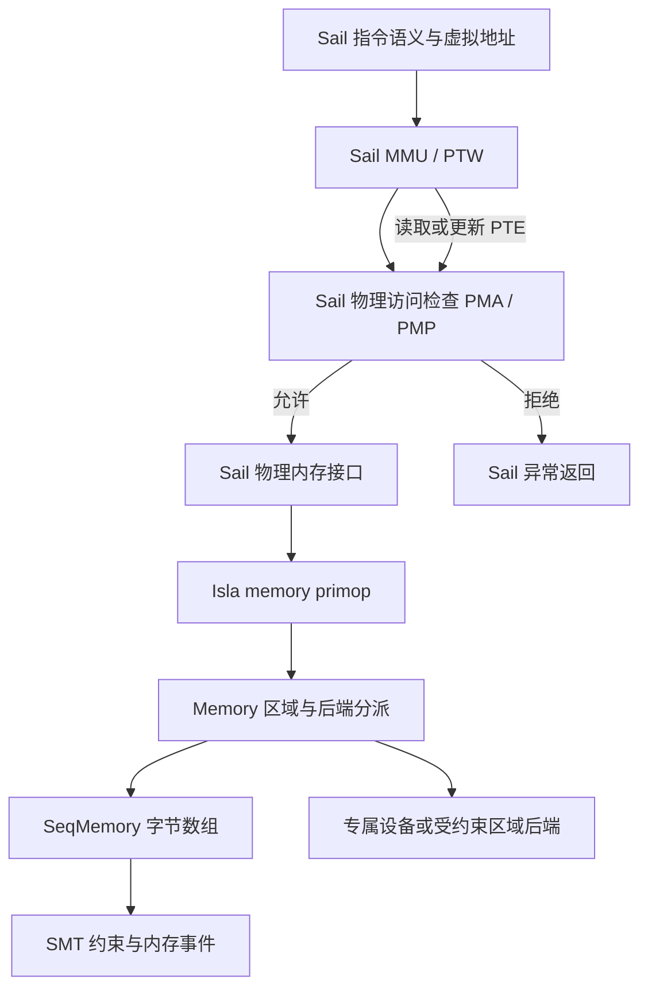

# Isla 内存符号化架构调研与初步结论

日期：2026-11-02。本轮为源码与架构调查，不修改生产源码，不运行新的性能基准或硬件验证。

**结论：现有“解释 Sail 硬件语义＋按路径维护字节 SMT 数组”的分层方向正确。应保留 SeqMemory，先完成具体/符号状态统一及见证合同，再用共享快照、范围证明与有限域探索控制开销。是否改用分页数组，需要测量决定；不能用宿主内存分区代替 Sail 的 MMU/PMA/PMP。**

## 1. 证据与版本边界

- 指定 Isla worktree 的 HEAD 为 `bdd047bc67c357f3c6e9c4d34b5ec9daaf81ab57`，分支为内存一致性开发线。工作树存在在途修复，不能把 HEAD、当前源码和已有二进制视为同一版本。
- 对照 isla-testgen HEAD 为 `cc4c613410766006c8a14ecf8787c66839c17597`；其 findings.md 已暂存，依赖子模块有本地状态。本轮直接核对 src/execution.rs 与 src/target.rs，不将 findings.md 当成实现证明。
- 现有[协同审阅](../coordinated_memory_review_20261102/report.md)针对已提交版本记录了具体/符号初态分裂等反例；[修复议题](../coordinated_memory_fixes_20261102/status.md)在本次观察时仍标为实施中。
- 当前未提交源码已增加 concrete 非零初态导入、按需零值约束、具体地址读走数组、专属后端重叠检查，以及 GPR 必输出等逻辑。本轮只确认实现存在，没有替修复议题宣布 PASS。
- 本轮读取期间 memory_model.rs 有变化；本报告机制描述以 [source-fingerprints.json](source-fingerprints.json) 的定时读取为准，不声称包含之后的修改。
- 辅助核对根 Sail-RISC-V checkout 的通用访存调用链，其 HEAD 为 `4f2ac293654a02db26dac5055be7f93fd6e3141e`。它不是本轮内存协同审阅的模型提交 c70482a7，也不替代生产 IR 的来源证明。
- angr/KLEE/QEMU/AFL++ 的比较依据本轮获取的上游代码及文档，来源见末节。未做工具间性能实验。

## 2. 架构定位：被符号化的是 ISA 规范执行

### 2.1 职责分界

| 层 | 当前职责 | 不应混入的职责 |
| --- | --- | --- |
| Sail ISA 模型 | 地址形成、地址转换、PTW、PMA/PMP、对齐、异常优先级、LR/SC 相关控制流 | 测试生成器的地址采样偏好 |
| Isla 执行器 | 解释 IR、符号值与 primop、路径条件、fork、执行预算和 SMT checkpoint | 重新实现一套 RISC-V MMU |
| Memory / MemoryCallbacks / SeqMemory | 按物理地址读取和更新字节；安装初态；区域与专属后端分派；内存事件 | 用 RAM 白名单决定架构访问异常 |
| Target 与生成配置 | 架构寄存器形状、PMA/PMP/CSR 初态注入、符号化范围及受测域 | 把宿主存储页当作 guest 页表 |
| 最终模型与输出 | 用同一 SMT Model 导出输入、内存访问、返回值及可提供的后态 | 用另一组随意具体值拼成重放输入 |

普通访存的概念调用链如下；PTW 的 PTE 读写还会再次进入物理访问检查及内存接口：



这里展示职责，不宣称所有指令检查次序完全相同。异常优先级以实际 Sail 函数为准。Sail 中也可能在到达通用回调前分派 MMIO；CustomRegion 是执行器可提供的另一种后端边界。

这使页表字节成为符号执行的普通输入：一个 PTE 的值可以改变下一次物理地址、页表层级及最终异常。普通应用分析经常把这些机制放在环境模型之外；本项目需要探索它们本身。

还有两个定位边界：

1. SeqMemory 建立的是**单条执行路径内按事件顺序的读写一致性**，没有因此建立多核 RVWMO、跨 hart 读来源或并发原子性证明。
2. Isla 通用 Memory 的 fresh-read 行为有事件式并发分析的历史用途。它不是本项目顺序测试生成的等价后端；重复读独立取值会扩大允许行为，不能用来签收同址一致性。

### 2.2 地址宽度不等于 XLEN

当前 solve-state 安装 64 位数组索引，原因是 Sail Mem_read_request / Mem_write_request 使用 64 位接口。RV32 的物理地址也可能是 34 位，再零扩展到 64 位。优化时应遵循实际接口类型，不能直接把数组索引降为 XLEN。

## 3. SeqMemory 的实际机制

### 3.1 数组、字节与 alias

内存用 `Array(BV64, BV8)` 表示。它是逻辑上的地址到字节映射，不是分配 2^64 个字节。

用 M 表示当前数组，小端 4 字节读取和写入可概括为：

```text
read32(a) = concat(M[a+3], M[a+2], M[a+1], M[a])
M1 = store(store(store(store(M0,a,d[7:0]),a+1,d[15:8]),
                 a+2,d[23:16]),a+3,d[31:24])
```

每次写定义新的数组符号，回调更新自身 memory_var；不是原地改变旧数组。读生成 fresh 位向量，再断言它等于当前数组上的 Select/Concat。

因此同址重复读、写后读和部分重叠读写可以自动关联。若写 a 后读 b，求解器必须考虑 a=b 或 a≠b，及多字节访问的偏移重叠。**数组访问本身不要求执行器为每个可能地址 fork**；alias 可以留在 SMT 中处理。

### 3.2 MemoryCallbacks 的边界

Memory 负责分派并创建 ReadMem/WriteMem 事件。SeqMemory 回调负责添加数据关系和更新当前数组符号。

当前接口中有两种不同布尔信息：

- constrains_symbolic_reads/writes 控制是否跳过旧的 concrete-overlap 预检查；
- symbolic_read/write 的返回值表示是否追加了需要立即检查的地址约束。

它们不是访存成功位，也不是“这个地址得到 PMA 允许”。当前 symbolic region 声明不产生地址白名单；excluded 区域才增加“不与该区域重叠”的约束。零 excluded 时，回调不会为每次普通访问额外触发这项立即可满足性检查。

接口名和部分旧注释仍带有历史“区域白名单”语义，值得在正确性修复后收敛；直接依名称推断职责会误判。

### 3.3 路径 fork 与真实复制成本

遇到两侧都可达的 Sail 条件时，执行器保存 SMT checkpoint，冻结另一条路径，并分别加入条件和其否定。冻结/解冻帧会 Clone Memory，回调中的数组符号因此按路径保存。

这意味着两个不同事实同时成立：

- SeqMemory 只克隆少量符号编号，不会在 Rust 中复制一整个逻辑 SMT 数组。
- Region::Concrete 持有标准 HashMap，Clone 会复制其实际条目；freeze_frame 和 unfreeze_frame 目前都克隆 Memory。Frame 外包 Arc 不等于底层字节已经页级 COW。

Solver::from_checkpoint 会创建 solver 并重放轨迹。因此，SMT 前缀在轨迹数据结构中的共享，也不等于后续任务免费共享全部 Z3 求解状态。

### 3.4 Concrete / Symbolic 混合的现状

已提交 bdd047bc 的分裂已被旧探针证实：具体地址可读取 concrete 快照，而符号地址读取无对应初态约束的数组。写数组后具体读取也可能回到旧快照。

当前在途修复采用如下机制：

1. 建立自由基础数组 initial_var。
2. 将 concrete 区域内显式非零字节编码为 Store，形成初始 current 数组；每 64 条初始化项命名一个中间数组。
3. 每次读取时，对属于 concrete 区域的各字节地址，约束基础数组该处为零。
4. 普通内存的具体地址读取也进入数组；因此初始非零覆盖和后续写入都可被读到。
5. Custom/Constrained 区域继续分派给专属后端。符号地址可能碰到专属区域而又不唯一时，当前实现报错；没有自动拆成 RAM 与设备两条状态。

第 3 步约束的是**基础数组**，第 2 步的非零值是其上的 Store；两者并不要求同一最终字节同时为零和非零。

这是一种无需量词的按需初态编码，方向合理。但仍有稀疏非零初始化链、每字节扫描 concrete regions、重复零值约束以及设备歧义处理的开销。本轮未验证新实现的所有边界。

默认 CLINT 在 MemoryBuilder 中安装的是 zero concrete 区域，不能从区域名称推断已获得完整的计时器、中断或其他设备语义。

### 3.5 异常与结果合同

PMA/PMP 拒绝是 Sail 的合法执行结果；excluded 是生成策略裁剪，两者不能混用。访问在模型层被拒绝时，可能根本不会调用目标数据的数组读写。但异常前可能已有 PTW 读取、A/D 更新或向量部分访存，不能把“异常”统一解释成“没有任何内存副作用”。

当前独占写一旦到达回调即提交，相关 Bool 被约束为 true。这依赖当前 Sail write_ram 对 Ok(_) 返回 true、SC 失败在更早控制流处理的约定。它不能直接推广为一般 CAS、失败写或多核 reservation 模型。

旧报告还发现漏导出自由 GPR、返回值含 Sym、ModelEval 错误被吞等问题。当前已有针对性修复代码；它们共同说明：**数组求解正确不自动保证导出的测试可重放。** 必需输入、访问数据、异常和后态必须来自同一最终 Model，字段失败应进入不完整诊断。

## 4. 与 isla-testgen 的比较

**两者同属 Sail 规范执行，核心数组机制有直接谱系关系。差别在测试生成目标、允许域和环境约定。**

| 维度 | isla-testgen 当前源码 | isla-runner 内存开发线 |
| --- | --- | --- |
| 普通数据 | 字节 Select/Store、按路径保留数组符号 | 相同基本机制 |
| 地址域 | smt_address_constraint 按 ReadInstr/ReadData/WriteData 限制 region；标签也参与约束 | 默认不以 symbolic region 圈地址，让 Sail PMA/PMP 保留成功和 fault 域 |
| 页表 | translation_table_exp 对特定表独立编码 | MemoryBuilder 构造页表内存；当前修复将 concrete 初态接入统一数组 |
| 能力标签 | 独立 1 位 tag array、地址对齐掩码及无标签区域 | 当前 RV64 回调拒绝带 capability tag 的读取/写入 |
| 具体内存限制 | 注释明确不支持符号访问 Concrete、也不支持写特定 translation table | 当前需求正在突破这项限制 |
| 驱动方式 | 初始化、逐指令延续、最终提取及专属目标测试生成 | Clause/状态求解、编码守卫、JSON 及后续重放链路 |

testgen 的 translation_table_info 甚至明确说目前只需要一个入口、且用于 Morello。其受限读取通过 ITE 返回该入口或零；它不是可直接复用的任意 RISC-V 多级、可变页表实现。源码注释还直说，往数组加入大量页表数据曾使求解显著变慢；这是其设计动机，不是本轮对当前版本的性能测量。

它可以这样做，因为生成器主动保证测试适合既定 harness：限制地址区域、提供固定环境、排除不能导出或执行的行为。这对目标集合可以合理，但不能据此推导覆盖完整 ISA 状态空间。

本项目要保留权限错误、PMA 边界、页表错误、符号环境及部分完成等情况。直接照搬白名单会在 Sail 产生合法异常之前剪掉输入。可借鉴的重点是可配置目标约束、标签分离和最终状态提取；页表特化必须附带清楚的适用条件。

## 5. 与 angr、KLEE、QEMU/AFL 的本质比较

### 5.1 angr：分页存储与地址策略配合

本轮获取的 DefaultMemory 继承组合包括 AddressConcretizationMixin、UltraPagesMixin、PagedMemoryMixin 和 ActionsMixin。页面用引用计数实现 COW；符号数据以表达式保存。

因此，“angr 默认就是平坦 SMT array”不准确。其默认读地址策略包含有限范围解析，之后可选单解具体化；写也有范围与单点策略。具体配置决定保留多少符号地址可能性。分页节省状态复制，地址策略控制访问需要处理的候选集合，两者解决不同问题。

SimAction 记录地址、数据、条件和附加约束，用于观测与依赖分析；它不是另一套保证内存一致性的存储。

可借鉴：页级共享、具体字节快路径、符号字节表示、显式地址策略、访问原因追踪。不能直接采用：把某个可满足地址当成唯一地址，随后仍声称探索完整。

### 5.2 KLEE：对象归属与对象内偏移

严格说，KLEE 通常执行 LLVM bitcode，不是原生二进制解释器。其程序内存对象包括栈分配、堆分配和全局对象。

AddressSpace 将地址解析为 MemoryObject；ObjectState 同时保存 concreteStore、符号字节和 UpdateList，并在写入时 COW。具体地址可走有序索引；符号地址需证明对象归属，必要时枚举候选对象并分叉边界条件。对象模型依然需要数组/更新列表式表达，不会消除对象内 alias。

本项目的 PA 是裸地址，通常没有 malloc/allocation provenance。越过 KLEE 分配对象边界可能是程序错误；越过执行器内部 RAM 页或分片边界可能是完全合法的 RISC-V 访问。

可借鉴对象解析的“先索引候选、再用 solver 证明范围”和对象级 COW，但这里的对象应是后端存储单元，不能新增 ISA 不存在的访问边界。软件写 PTE 和 PTW 读 PTE 必须通过同一 PA 保持 alias。

### 5.3 QEMU/AFL：具体状态吞吐与恢复

QEMU 的 MemoryRegion 将 RAM 映射到宿主内存，MMIO 通过回调，另有 alias、container 等映射结构。AFL 类执行通常对每个输入运行一个具体实例；fork-server 利用进程 COW 降低启动成本，persistent 模式要求正确重置跨迭代状态。二者没有自动提供符号地址全集或路径覆盖证明。

这里也要避免另一种过度对比：QEMU 全系统仿真同样会在软件中实现 guest 地址转换、权限及异常。差别是它对一次具体状态运行经优化的实现代码；本项目把 Sail 的通用模型本身解释为符号约束和可探索控制流。

可借鉴：冻结初始化、增量快照、稀疏后端、设备分派和高吞吐重放。快照必须覆盖寄存器、CSR、内存、模型 TLB、reservation、设备及外部状态；只恢复 RAM 不能保证执行可重复。

## 6. 优势与瓶颈判断

### 6.1 现有优势

- Sail 保留地址转换、保护和异常优先级，减少手写第二套硬件语义的偏差。
- 字节数组自然处理同址、部分重叠和跨宽度访问；对裸物理地址比强加分配对象边界更直接。
- 现有 MemoryCallbacks 已是合适扩展点，不必重写执行器才支持更好的存储表示。
- 同一套求解可以生成成功、访问错误、页错误及权限边界见证，也能研究页表字节、CSR 与结果之间的关系。
- 路径内数组版本和事件轨迹提供了可检查、可导出的解释基础。

### 6.2 开销必须分层归因

| 现象 | 实际来源 | 优先手段 |
| --- | --- | --- |
| 写后读越来越难 | Store 历史与读写 alias，符号地址算术 | 非 alias 证明、读写转发、局部分片 |
| PMA/PMP/PTW 路径增多 | Sail 控制流与初态组合 | 按模型语义分域、缓存已证明条件、探索调度 |
| fork 时 RSS/复制增大 | concrete HashMap、执行帧状态 | 不可变共享基底、持久化结构、COW |
| 恢复任务耗时 | checkpoint 的约束/事件重放 | 测量重放占比，再考虑调度局部性与增量复用 |
| SymbolicLength | 动态宽度/切片不能表达为固定 SMT 位宽 | 唯一值证明、有限宽度特化 |
| JSON 无法重放 | 最终模型选择和必要状态导出不完整 | 统一见证与错误传播合同 |

声明 64 位地址数组本身不会导致内存规模爆炸。若累计写入 W 个字节，原始 Store 构造大体随 W 增长；复杂性来自无法简化的读写关系和路径组合。新数组符号命名不表示一定按指数展开 AST。不能在缺少指标时把所有超时归为“数组太大”。

一个 Sv39 访问可能包含多个 PTE 读取、权限与保留位判断、A/D 处理，再到最终数据访问。向量访存还叠加元素数、掩码、段数、对齐及异常位置。这些成本在进入最后一次 RAM 回调前就可能已经出现。

### 6.3 SymbolicLength 的特定边界

Memory::read 需要具体字节数。primop 的 subrange_internal 还需要确定切片结果宽度；即使数组能用符号地址，也不意味着 SMT 位向量类型能有符号位宽。

现有协同审阅中，自由地址 store 的一条路径在 vmem_utils.sail 的动态切片报 SymbolicLength，整组为 partial。这是既有记录，不是本轮新运行。

建议优先区分三种情况：宽度在路径约束下唯一、宽度属于小型有限集合、宽度无法给出合理上界。前两种可以证明后具体化或有限特化；第三种应保留不完整诊断，不能任取一次值后标完成。

### 6.4 当前尚未闭合的语义边界

- Custom/Constrained 的符号地址多候选目前会被拒绝，仍是探索能力缺口。
- CLINT 的 zero concrete 表示不等于真实设备模型。
- capability tags、完整 LR→SC 关系、多核弱内存不是当前 SeqMemory 自动提供的能力。
- 成功 load 的目的寄存器、向量部分完成后的完整后态等，仍须按当前 JSON 合同逐项确认。
- 原注释将 Concrete 称为只读，但数组启用后的职责正演变为已知初态；内容已知、可写权限和可生成地址域应分开表达。

## 7. 建议的演进路线

### P0：先完成语义与见证闭环

沿现有修复议题完成：同一 PA 的具体/符号读取一致；后续写入统一可见；预置页表初态正确；必要寄存器和异常用同一最终 Model 导出；ModelEval 失败不得生成伪完整条目。

关键回归应包含：符号写后具体读、部分重叠、跨 concrete/symbolic 边界、fork 隔离、软件改 PTE 后 PTW 可见、A/D 更新后普通 load 可见、异常前副作用及设备歧义。对 Sail 自身 TLB 的测试还需遵守 SFENCE.VMA/失效语义，不能要求未失效的旧翻译立即变化。

### P1：低语义风险的宿主存储优化

1. 将 concrete 初态字节改为共享不可变结构，避免每个 fork 深拷贝。
2. 对区域建立有序区间索引，具体地址查找不再线性扫描。
3. 在同一初始数组与路径条件下缓存已添加的初态约束，避免重复约束。
4. 记录初始化 Store 数、读写字节数、数组版本数、alias 查询、solver 耗时、fork/RSS、checkpoint 重放及 ModelEval。

这些修改不会自动减少 Sail 分支。PMA/PMP 有首匹配、全区间包含、权限和异常优先级；区间索引首先应用于内容后端，不能用简单“起始地址命中”替换其语义。

### P2：证明后使用混合快路径

可以保留统一物理地址空间，同时用 concrete 基底＋符号覆盖表示内容。具体读只有在**证明没有在先符号写可能覆盖**时才能直接返回基底；否则必须进入符号覆盖求值。

同样，可以在地址被证明唯一时改走具体分派。这与任选一个可满足地址不同：前者保持当前路径等价，后者只探索一个子集。对符号写采取样本地址之前，必须记录覆盖收窄。

### P3：按证据尝试稀疏分片

若测量证明 Store/alias 主导，可尝试“稀疏宿主页目录＋每页字节表达/数组”。这里的页只是存储单位，不是 RISC-V 虚拟页，也不是新的权限边界。

- PA 的页号已唯一：只访问对应分片。
- 少数可行页：用完整候选枚举或条件更新，并覆盖跨页字节。
- 页号广泛符号化：仍需保留全局符号表示或明确进入采样策略；哈希表无法独自解决符号 key。
- 不同 VA 映到相同 PA 时必须共享同一分片。软件访问与 PTW 访问也必须共享。

分页主要带来复制和局部性的收益；广泛符号写仍可能污染许多页，甚至使跨页候选数增多。因此不能承诺分页必然比单数组快。

### P4：把环境固定、concolic 与异常探索设成显式策略

可分别设置受测配置：

- 固定硬件平台参数和 PMA 地图，探索指令数据及合法运行上下文。
- 定向探索 PMA/PMP 边界、PTE 错误及异常优先级。
- 从具体种子执行，再翻转选定分支，求解新输入并回到完整 Sail 模型重放。

这些策略有不同覆盖合同，不应静默替换默认全符号探索。不能为提速把 vl/vstart/vtype 等真实运行态随意固定为代表值。

对动态访问宽度，优先复用现有 monomorphization 和唯一值证明；按真实有限集合分批执行并报告未完成分片。用于地址采样的模型值要断言回路径，且保留剩余域或明确标注未探索。

### P5：保留 Sail 语义权威，谨慎引入摘要

如果 PTW/PMA/PMP 成为主要耗时，可研究函数级摘要、翻译缓存或等价特化。但摘要必须覆盖异常、页表依赖、A/D 更新、PMP/PMA 状态、TLB/SFENCE 和相关 CSR。缓存失效条件必须明确。

只用 VA 缓存 PA 或把页表永久独立于普通内存，会错过权限变化、页表写入和页表 alias。优先做解释器内部等价优化和共享状态；手写 MMU 摘要属于更后阶段，需要对照原 Sail 实现验证。

## 8. 初步实验矩阵与接受口径

建议将具体地址、唯一符号地址、小型候选集、广泛符号地址交叉组合于：无前写、同址前写、不重叠前写、PTW、PMA/PMP 拒绝、向量部分完成。保持 IR、配置、Z3、预算、指令编码与见证要求一致，再比较单数组与候选后端。

至少记录 wall/CPU、峰值 RSS、fork/终态数、SMT 声明/Store/Select 数、check-sat/ModelEval/重放耗时、partial/error、同覆盖下的可重放见证数量。耗时下降而合法异常或别名案例减少，应报告为探索域变化，不能写成同覆盖优化。

本轮没有实施候选架构、运行上述矩阵或声称性能收益。

## 9. 源码入口与外部来源

本地入口：

- [SeqMemory](../../isla/.worktrees/memory-consistency/src/isarch/memory_model.rs)
- [Memory 与回调](../../isla/.worktrees/memory-consistency/isla-lib/src/memory.rs)
- [Target 注入与初态输出](../../isla/.worktrees/memory-consistency/src/isarch/target.rs)
- [初态和页表构建](../../isla/.worktrees/memory-consistency/src/isarch/memory_builder.rs)
- [执行帧快照](../../isla/.worktrees/memory-consistency/isla-lib/src/executor/frame.rs)
- [checkpoint 与 solver 恢复](../../isla/.worktrees/memory-consistency/isla-lib/src/smt.rs)
- 外部对照仓库 isla-testgen：src/execution.rs 的 SeqMemory、setup_init_regs；src/target.rs 的 TranslationTableInfo、translation_table_exp 及 Morello Target。

本轮成功获取并核对的上游来源（远端分支会继续演进，不视作本地依赖的精确版本）：

- [angr 默认内存组合](https://github.com/angr/angr/blob/master/angr/storage/memory_mixins/__init__.py)
- [angr 地址具体化策略](https://github.com/angr/angr/blob/master/angr/storage/memory_mixins/address_concretization_mixin.py)
- [angr 页面 COW](https://github.com/angr/angr/blob/master/angr/storage/memory_mixins/paged_memory/pages/refcount_mixin.py)
- [angr SimAction](https://github.com/angr/angr/blob/master/angr/storage/memory_mixins/actions_mixin.py)
- [KLEE AddressSpace 与 COW](https://github.com/klee/klee/blob/master/lib/Core/AddressSpace.cpp)
- [KLEE MemoryObject/ObjectState](https://github.com/klee/klee/blob/master/lib/Core/Memory.h)
- [KLEE executeMemoryOperation](https://github.com/klee/klee/blob/master/lib/Core/Executor.cpp)
- [QEMU Memory API](https://www.qemu.org/docs/master/devel/memory.html)
- [AFL++ persistent 模式及状态重置](https://github.com/AFLplusplus/AFLplusplus/blob/stable/instrumentation/README.persistent_mode.md)

没有将 QEMU 某个具体 RISC-V PTW 文件作为已核实源码证据；本轮该文件获取未成功。
