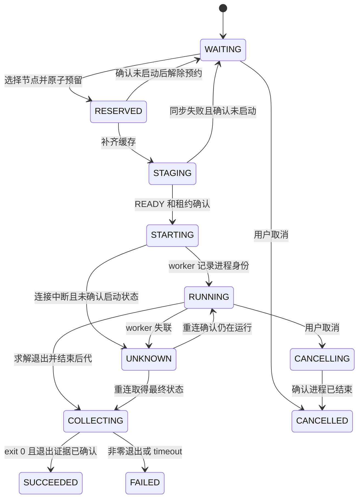

# Make solve 与无容器多机调度的衔接方案

> **QoS 修订（2026-11-10）**：按用户最新确认，门槛统一改为任务声明线程数的 `max(1, cores // 2)`；stop_free_cores 不再必填或参与调度。下文固定 16 核与 `min(R, stop_free_cores)` 的公式、示例属于历史方案；现行规则见 [README.md](README.md) 和 [NATIVE_STATUS.md](NATIVE_STATUS.md)。

> **本地执行修订（2026-11-10）**：按用户最新确认，local=true 直接在原请求 cwd 运行，不冻结、不缓存、不 stage、不 SSH，也不建立 attempt 工作树；完整日志与全部产物原地写入。下文的缓存、运行库重定位和 attempt 隔离仅适用于远端任务，原先关于本机缓存共享的描述保留为历史方案。现行实现和验证见 [本地执行状态](NATIVE_STATUS.md#本地就地执行修订)。

> **实施更新（2026-11-10）**：纯 Python + SSH 后端、Make 接点、缓存、QoS、日志、取数与测试已落地。现行用法见 [README.md](README.md)，实测结论见 [RESULTS.md](RESULTS.md)，限制见 [NATIVE_STATUS.md](NATIVE_STATUS.md)。以下保留实施前方案及当时调查事实；“拟新增”“待实施”描述属于原稿。
>
> 按用户本轮零依赖要求，第三方 Bash AST 库改为标准库 shlex 的有限语法检查；不支持的 recipe 直接拒绝。传输改为原生 SSH 的结构化协议与文件版本增量，不依赖 rsync。当前保留每节点单 controller 互斥；主控自动恢复、动态外部资源估计、run 级日志限流和大文件内部差量尚未实现，不能视为已完成。两个远端被会话网络沙箱阻断，未取得真实集群求解 PASS。

**推荐保留 Make 负责选任务、展开参数和打印进度，在原 recipe 的 `exec` 处接入分发器。输入按工作区建立不可变缓存，每台节点只接收缺少的文件；任务只提交参数和文件清单。**

在当前代码中，接点需要由 `scheduler/` 提供的附加 Makefile 和 shell 入口安装。只用 `PATH` 包装无效，因为 recipe 写死了可执行文件路径。推荐的是 **C 作为接入手段、A 作为任务边界**：shell 执行原 recipe，在调用 `solve_process.py run` 时交给调度器。B（`make -n`）用于预览，不作为执行引擎。

例如，把 `solve-VXTYPE` 的外限从 90m 改为 100m，下次 Make 展开的真实 argv 就带 100m。调度器不保存第二份超时规则。把某个 clause 的 workaround 换成新路径，分发器从同一份 argv 找到文件，补入缓存后再运行。

**本文是待实施方案，日期为 2026-11-10。** 本轮仅做源码调查、原生 Make dry-run 和局部机制实验，未实现分布式入口，未部署无容器服务，未做真实远端求解。所有拟新增代码和配置均限于 `scheduler/`；不修改 `isla/`、模型仓、根目录状态文件或正在运行的实验。

## 1. 当前代码到底做了什么

### 1.1 Make 是唯一业务规则来源

核对对象为 Isla 工作区 HEAD `a38c5e02`、Sail-RISC-V HEAD `cbb4766f`，以及本轮实际读取的工作区文件。可复用事实列在本文，按本次目录限制不写回根目录的 `agents/findings.md`。

| 对象 | 当前行为 | 对设计的影响 |
| --- | --- | --- |
| [run.mk](../isla/scripts/run.mk) 的 `solve-%`，228–234 行 | 依赖 `build-isarch`；先建目录，再取进度号，最后 `exec /usr/bin/python3 scripts/solve_process.py run ...` | 编译留在主控；分发必须在进度打印之后、timeout 启动之前 |
| `build-isarch`，221–222 行 | 本地 `cargo build --release --bin isarch`，构建 feature 随 trace 和 SMT 配置变化 | 不能在 Make 编译前冻结二进制；不能用包装文件覆盖构建产物 |
| 组入口，236–265 行 | `solve`、`solve-fd-float`、`solve-fd-nonmem`、`solve-memory` 选择不同依赖；目标专属变量沿依赖传播 | 不在调度器复制 clause 名单、配置选择或 `TOTAL` 公式 |
| 目标专属变量 | 如 VXTYPE 默认外限 90m、路径预算 85m；浮点计算选 qffp，其他任务选 qfaufbv | 只读最终 argv，不能用全局默认值猜测任务参数 |
| `SOLVE_CONFIG` / `ISA_CONFIG` | `SOLVE_CONFIG` 非空时优先；FD 组和部分目标有自己的 `ISA_CONFIG` | 分发器看最终 `-C`，不重新实现 Make 的优先级 |
| `THREADS` | 默认 64，由 `-T` 传给 isarch | `-j208` 是最多 208 条 recipe，不是 208 核；32 线程示例必须显式用 `THREADS=32` |
| `COUNTER` 与 `solve-pre` | `output/.solve_progress_counter`，由 `flock` 原子递增；组入口传入 `SOLVE_TOTAL` | 原生 `[n/TOTAL]` 表示 recipe 已启动，不能冒充远端完成数 |

当前默认 `solve` 排除 FD 和 MEMORY 两组。组集合有交集，多个组同时作为 Make goal 时还涉及去重和变量继承。第一版支持每次一个组入口，或显式单目标；不承诺把多个组的原生进度自动变成去重总数。单目标原生调用没有组入口提供的 `SOLVE_TOTAL`，需要完整分母时显式传 `SOLVE_TOTAL=1`。

### 1.2 当前执行与退出语义

简化后的真实命令如下。省略项仍须原样保存，不能照此重造命令：

```text
RUST_BACKTRACE=1 exec /usr/bin/python3 scripts/solve_process.py run --clause MRET --
  timeout --signal=TERM --kill-after=10s 60m ./target/release/isarch
  -A ./rv64d.ir -C ./configs/riscv64_difftest.toml ... -T 64
  --timeout 55m --smt-timeout 1m --tastic qfaufbv solve-state --clause=MRET
  > output/log/MRET.log 2>&1
```

[solve_process.py](../isla/scripts/solve_process.py) 的 `run` 要求后面的命令以 `timeout` 开头。它启动专属进程组，处理 INT/TERM，清理同组后代，再返回实际退出码。它还写入 `output/process/<clause>-<pid>.json` 和 `output/status.{intime,timeout,failed}.log`。它不负责远程任务管理。

必须保留三种时间的区别：外层 `timeout` 限制整条运行；isarch 的 `--timeout` 是单条路径活跃时间预算；`--smt-timeout` 限制单次 Z3 operation。排队和传输入口不启动原 timeout。远端准备完成后，才运行原监督器及其 timeout。

### 1.3 输入体积、缺失项和隐藏依赖

以下大小来自本轮 `stat`，不以历史记录代替当前文件。不计算全仓哈希。

| 路径（相对仓库根） | 本轮实况 | 分发方式 |
| --- | --- | --- |
| `isla/target/release/isarch` | 65,172,208 bytes，约 62.2 MiB，动态链接 x86-64 ELF | 编译后进入运行时缓存，同节点同版本共享 |
| `isla/rv64d.ir`、`isla/rv64d.irx` | 当前均不存在 | 实施验收前提供实际 `IR_FILE`；缺失时提交失败，不向远端发空任务 |
| `isla/configs/**/*.toml` | 28 份，合计 172,241 bytes | 小型配置树增量镜像 |
| 默认 `riscv64_difftest.toml` / FD 配置 | 4,112 / 2,810 bytes | 最终 `-C` 指定哪个，就确认哪个存在 |
| `sail-riscv/configs/isla/workarounds/*.toml` | 79 份，合计 79,969 bytes；VVTYPE 为 7,293 bytes | 保留模型仓相对层级，按展开后的路径自动加入 |
| `isla/scripts/solve_process.py` | 实际执行的监督器 | 与任务所用脚本版本一起冻结 |

IR 的实际体积本轮无法报告，因为默认文件缺失。后文的 300 MiB IR 仅为传输算例。`IR_FILE` 若指向 `.irx`，直接传指定文件；[opts.rs](../isla/src/opts.rs) 按扩展名加载，不需要凭名字猜一份 `.ir` 配套文件。

`ldd` 还确认了 `libz3.so.5.3`、libstdc++、libgcc、libc、libm 和 ELF loader。当前 Z3 位于主控用户的版本化安装目录，不能假设远端具有同一个绝对路径。只传 isarch 和 IR 会漏运行库。

### 1.4 结果不只在 outputs/

| 路径（相对执行 cwd `isla/`） | 内容 | 默认策略 |
| --- | --- | --- |
| `output/log/<clause>.log` | recipe 重定向的 stdout/stderr | 主控保留有界实时日志与最终尾部；远端保存完整日志 |
| `output/trace/itrace_<clause>.txt` | 可选 itrace/ftrace/btrace | 留在执行节点，按需取回 |
| `output/process/*.json`、`output/status.*.log` | 原监督器的退出证据 | 小文件回传并按 job ID 归档 |
| `output/<arch>_<clause>.json` | 实际生成结果，见 [exec.rs](../isla/src/isarch/exec.rs) 的 `solve_state_main` | 留在节点；回传路径、大小、完成状态 |
| `output/timeout-smt/` 或显式 `--timeout-smt-dir` | 可选 SMT dump | 留在节点，摘要列明位置 |
| `outputs/` | recipe 会创建；不代表全部结果都写这里 | 同样登记实际产物，不能只收这个目录 |
| TOML 内声明的样本输出路径 | 取决于 `[execution_limits.merge_enumeration]` 等配置 | 作为输出处理，不能误当输入上传 |

本轮看到 `output/log`、`output/trace`、`output/process` 均已有文件。新入口不能清空这些目录或把历史状态行计入本轮完成数。

### 1.5 scheduler/ 的现状与迁移边界

现有 [PLAN.md](PLAN.md)、[README.md](README.md) 和脚本实现的是**容器化 HTCondor**，不是已经可用的无容器轻量调度器：

- `common.py` 通过 `sudo docker exec` 调用 Condor。
- `submit_job.py` 需要人工传 `--input`，每任务制作 `payload.tar.gz`；输入按 basename 放进 `inputs/`。
- `job_runner.py` 将每个包展开到持久 attempt；日志只在完成后回传尾部。
- `nodes.conf` 已有本机 128 CPU、preston 32 CPU、4090 节点 48 CPU，共 208 CPU。
- 当前没有本文所需的节点优先级、权重、余量门槛、工作区缓存或 Make 接口。

推荐在 `scheduler/` 新增独立的原生 Python 主控与 worker，以 SSH 为控制和传输通道。使用已有 `nodes.conf` 的地址、`work_dir` 和数据保留约定；加载独立的轻量后端配置段。旧 Condor 路径保留历史适用范围，不能把旧单元测试记为新系统通过。

切换时先停止旧系统接单、等待其活动任务结束，再启用新后端。两套系统不得同时把同一组 208 CPU 全额算作自己的空闲容量。无容器路径不调用 Docker，不要求安装 Condor，也不替换已有系统服务。

## 2. 三种 Make 接法的取舍

| 接法 | Makefile 修改何时生效 | 原生进度与 `-j` | 当前限制与结论 |
| --- | --- | --- | --- |
| A：直接包装 isarch | Make 照常求值，传入新参数即可生效 | 进度保留，recipe 必须阻塞至远端完成 | 路径写死为 `./target/release/isarch`，PATH 无效；替换二进制会被 build 覆盖；本地 timeout 会把排队时间算进去。不选这个边界 |
| A：包装 `solve_process.py run` | 同上，且能接到完整 timeout argv | 保留进度、退出码和 Make jobserver | 边界正确，但原脚本由绝对 Python 加相对脚本路径直接调用；当前没有可注入的 dispatcher 变量。不能声称只放一个 PATH wrapper 就能接上 |
| B：`make -n` 提取展开命令 | 每次 dry-run 可反映目标专属变量和新 clause | 打印的是命令文本；原计数器、进度和 DAG 执行要另做 | dry-run 不构建输入；不能按行切开多行 shell，也不能删重定向后拼命令。递归 Make、`+` recipe、Make 求值副作用还可能执行。适合预览、受控契约核对，不作为运行入口 |
| C：将整段 recipe 当远端 shell 执行 | Make 展开即时生效 | 计数器和进度会散落各节点；编译/初始化还需区分 | 直接远端执行整段会破坏共享计数器和路径。拒绝“拦住所有 shell 就全部发远端”的做法 |
| **推荐：C 安装原生 shell 接点，在 A 的监督器边界分发** | **每次实际 Make 求值，真实 exec argv 直接提交** | **进度、flock、依赖图、`-j` 留在主控；proxy 同步等待** | 只增加 scheduler 内的附加 Makefile、shell 和 proxy；需要验证 Bash 与当前 POSIX recipe 的兼容，并明确支持的 runner 调用形式 |

长期若允许给 `run.mk` 增加一个显式 runner 变量，直接 A 会更简单。本轮不采用这条路径，也不把它作为落地前提。Python `sitecustomize` 注入、覆盖构建二进制、LD_PRELOAD 或 ptrace 拦截都不作为推荐实现。

### 2.1 用户入口与一次性接入

下列命令是**拟实现接口，目前不可执行**。未激活接入时，原生 `make` 仍只会本地运行；不承诺零接入动作就能远程调度。

```bash
# 从仓库根调用；-- 后交给 GNU Make。
python3 scheduler/scripts/make_solve.py -- \
  -C isla -f scripts/run.mk solve -j208 THREADS=32

# 其他原生组入口保持原名。
python3 scheduler/scripts/make_solve.py -- \
  -C isla -f scripts/run.mk solve-fd-float -j208 THREADS=32
```

可选的 `scheduler/scripts/activate.sh` 在当前交互 shell 安装 `make` 函数。它将适用的 solve 调用交给上述入口，其他调用交给 `command make`。激活后，用户在 `isla/` 仍敲：

```bash
make -f scripts/run.mk solve -j208 THREADS=32
make -f scripts/run.mk solve-memory -j208 THREADS=32
```

函数只改变当前 shell，不改 Make 可执行文件或用户启动文件。入口不得拼接或 eval 用户的 Make 参数；用 argv 数组启动真实 GNU Make。它必须保留 `-C`、`-f`、变量赋值、jobserver、信号和退出码。第一版不接管未知 make 实现或无法确认的工作目录。

入口对同一实际 cwd 的原生 output 和编译区域持有 run 级锁，避免两个 Make 同时重置计数器或更新二进制。第二次调用说明正在等待哪个 run；不同独立工作树可以并行。锁和登记文件放在 `scheduler/runtime/`，不改原 `COUNTER` 规则。

### 2.2 附加 Makefile 只安装接点

入口在用户已有 Makefile 后加载 `scheduler/integration/solve.mk`。示意如下，路径由入口确定：

```makefile
# 无 clause 清单，无 recipe 副本，无 timeout/ISA_CONFIG 业务规则。
solve-%: private override SHELL := $(SCHEDULER_SHELL)
solve-%: private override .SHELLFLAGS = --target=$@ -c
```

`SCHEDULER_SHELL` 指向 scheduler 内的 shell 适配器；`.SHELLFLAGS` 把实际 `$@` 作为参数传入。`private` 防止变量沿依赖传给 `build-isarch`；`override` 防止普通命令行赋值绕开入口。入口须先拒绝不支持的显式 shell 覆盖，不能静默忽略用户要求。`solve-pre`、`solve-kill` 等本地管理目标须显式恢复原 `SHELL` 和 `.SHELLFLAGS`，因为它们自身也匹配 `solve-%`。这几项是接入边界，不是第二份 clause 名单。

不全局设置 `.ONESHELL`，不复制 `solve-%` recipe，不重新执行一套 Make DAG。编译仍按原依赖运行一次；新 clause 只要仍走该 pattern rule，就自动接入。

### 2.3 让 shell 取得真实 argv，不分析 Makefile 文本

适配器使用 Bash 执行 Make 已经展开的 recipe。它定义一个 `exec` shell 函数，再由 Bash 解释原 recipe。Bash 完成引号、变量展开、环境赋值和重定向后，函数接收到真正的参数数组。

```bash
# 机制示意；省略身份检查、连接配置和错误处理。
exec() {
    if is_managed_solve_runner "$@"; then
        builtin exec "$scheduler_python" "$scheduler_proxy" -- "$@"
    else
        builtin exec "$@"
    fi
}
eval -- "$expanded_recipe"
```

这里的 `eval` 只执行本来就要由 shell 执行的 recipe；不用于解析 Make 参数或重建远端命令。`is_managed_solve_runner` 按 argv 和解析后的脚本身份匹配 `/usr/bin/python3 .../solve_process.py run`。远端用 argv 数组执行任务，不把用户路径重新拼进 SSH shell。

原有 `mkdir`、`flock`、计数器和 `echo "[n/TOTAL] ..."` 先在主控执行。原有 `> output/log/<clause>.log 2>&1` 已作用于 proxy，所以日志仍落到熟悉的位置。proxy 提交任务，等待远端完成，收到最终状态后返回相同退出码。

**支持边界必须写进实现。** 增删 clause、改变 flags、timeout、`-A`、`-C` 和 workaround 参数都自动同步。若改成直接运行 isarch、移除 `exec`、改用 `command exec`、换监督器或设置不兼容的 `SHELL`，就改变了接入协议，不能承诺自动兼容。

为避免这类结构变化偷偷变成本地求解，shell 适配器在执行**本次实际展开的 recipe**前，用维护中的 Bash AST 解析库核对结构；AST 是 shell 结构树，不是自写 Makefile 解析器。只接受已支持的本地准备命令或带受管 exec 的命令块。出现无法确认的动态构造、绕过接点或不支持的结构时，先报错再退出，不启动求解。实现前须固定解析库及支持范围，并验证引号、续行、重定向和 `.SHELLFLAGS`。不得用正则切 recipe 冒充这个检查。

`make -n` 仅用于用户预览和离线对照。实际任务不从 dry-run 文本生成，接入检查也不依赖两次 Make 求值一致。对存在递归 Make、`+` recipe 或求值副作用的未知工程，不自动运行一次 dry-run 作为无副作用的预检。

### 2.4 动态同步的准确含义

| 用户修改 | 下一次调用的行为 |
| --- | --- |
| 从 `ACTIVE_ALL` 增删 clause | GNU Make 改变依赖集合和原生 `TOTAL`，调度器无需改配置 |
| 目标专属 `OUTER_TIMEOUT`、`SOLVE_TIMEOUT`、`SMT_TIMEOUT` | proxy 收到新 argv，远端保留三层预算 |
| `THREADS=32` 改为 64 | isarch 仍用 64；调度器同时按 64 重新估算 CPU 请求 |
| `ISA_CONFIG`、`SOLVE_CONFIG`、`EXECUTION_LIMITS_CONFIG` 换路径 | 从最终 argv 找到新文件，冻结并同步新输入 |
| TOML 内容变化但路径不变 | 下一次输入冻结检测到变化，生成新文件版本 |
| 增加普通非文件 flag | 原样透传，不需要调度器理解其求解语义 |
| 新增隐含文件读取或新的 runner 形式 | 需要输入角色适配或接入协议升级，不能靠猜测保证完整性 |

Make 在启动时读取规则，不持续热加载。运行期间改 Makefile 只影响下一次 Make；已排队和运行的任务使用提交时的 argv 和输入版本。入口记录本轮 Makefile 内容和版本，检测启动期间的文件变动，拒绝把预检与实际执行混成两套规则。

## 3. 到底怎么知道传哪些文件

采用两层：**自动镜像少量已知工作区目录，真实 argv 补齐任务专属输入。** 用户不逐任务填写 `--input`；系统也不扫描上传整个仓库、Cargo target、`.git` 或历史 output。

### 3.1 工作区缓存与任务清单

```text
节点 <work_dir>/native/
  cache/<workspace-id>/
    objects/                         # 不可变文件，按文件版本共享
    generations/<generation-id>/
      root/isla/target/release/isarch
      root/isla/rv64d.ir              # 若实际 argv 指向此处
      root/isla/configs/...
      root/isla/scripts/solve_process.py
      root/sail-riscv/configs/isla/workarounds/...
      runtime/                       # ELF loader、动态库及运行入口
      manifest.json
      READY
  jobs/<job-id>/attempt-<attempt-id>/
    root/isla/                       # 执行 cwd；输入引用缓存，输出独立可写
      output/log/ output/trace/ output/process/ outputs/
    root/sail-riscv/configs/isla/workarounds/...
    task.json result.json
```

`workspace-id` 区分实际工作树，不只取 Git commit。`generation-id` 标识本次冻结的输入集合；不同 generation 可引用同一份未变文件。job manifest 保存原始 argv、有效远端 argv、cwd 映射、环境、文件角色、文件版本、资源需求和输出策略。

路径保留层级。例如从 `root/isla/` 执行时，`../sail-riscv/configs/isla/workarounds/vvtype.toml` 仍然有效。不能沿用现有 `inputs/<basename>` 打平方案，否则相同文件名会冲突，`../sail-riscv` 也会断开。

### 3.2 自动感知流程

1. Make 正常完成 `build-isarch`，第一条 proxy 到达输入冻结屏障。
2. 主控冻结共用二进制、监督脚本、小型配置目录和运行库；同一 workspace/run 只做一次。
3. 每个 proxy 上报真实 argv、cwd 和受控环境，识别 `timeout`、isarch 及参数边界。
4. 文件感知器解析文件参数，确认输入存在，记录输出目录并补充配置中的文件角色。
5. 主控将所需文件加入本轮不可变清单；同路径首次冻结后，本轮所有任务复用该版本。
6. 调度器为节点补齐缺少的文件，原子发布 `READY`，随后才允许执行任务。

第一条任务不能抢在编译前抓取二进制。后续任务发现不同的目标专属 IR/配置时，可为共用 generation 增加不可变扩展清单，无需重新传送共用 IR。

### 3.3 从 argv 识别文件，而不是猜所有字符串

建立一个小型 **isarch 文件参数角色表**，来源为 [opts.rs](../isla/src/opts.rs) 和 [isarch_main.rs](../isla/src/isarch_main.rs) 的真实 CLI。它描述哪些参数读文件、哪些写文件，不保存 Make 的 clause/超时/配置选择规则。

| 参数 | 角色 | 处理 |
| --- | --- | --- |
| `-A` / `--arch` | IR 输入 | 必须存在，加入缓存；支持分离参数、等号形式及 CLI 允许的短参数连接形式 |
| `-C` / `--config` | ISA TOML 输入 | 必须存在，解析其中已核实的路径字段 |
| `--execution-limits-config` | workaround 输入 | 由本任务最终参数自动加入，不按 clause 名另建映射 |
| `--encoding-slices-config` | TOML 输入 | 同上 |
| `--check-samples` | 样本输入 | 若使用则加入；语义有效性仍由模型检查 |
| `--itrace`、`--trace-output`、`--timeout-smt-dir` | 输出 | 不上传同路径旧文件；在 attempt 内创建对应位置 |
| `--check-samples-report`、`--check-samples-judge` | 输出 | 登记结果位置，不当输入 |
| `--clause`、`--timeout`、`--smt-timeout`、`--tastic`、`-T` | 非文件值 | 透传；`-T` 另用于 CPU 请求估计 |

用 CLI 参数库处理 argv token，支持 `--key=value`、`--key value` 和包含空格的单个参数。不得再用 `shlex.split` 处理已经分好的 argv，更不能把超时字符串当文件名。

作为补充，未知参数值若能解析为现有普通文件或目录，就自动加入清单；但这个启发式不承担完整性保证。输出角色优先于“文件已存在”的判断，避免把上次生成的 trace 再上传。未知文件 flag 指向不存在路径时，不应悄悄忽略；无法确认角色则在预检报告具体参数并停止。

普通新 flag 无需维护角色表。增加一种新的文件读写接口时，开发者补充一次角色表，用户不必每任务声明。任意程序都可能根据数据动态打开文件，单靠命令行无法自动证明全部依赖；方案不承诺这种通用能力。

### 3.4 TOML、相对路径与工作区外文件

通用镜像覆盖 `isla/configs/` 和模型的 `configs/isla/workarounds/`，合计只有约 246 KiB TOML。因而切换现有配置通常只改变任务清单，不增加大文件传输。

配置解析使用标准 TOML 库，并按真实加载器语义识别已核实的路径字段。例如 `execution_limits.merge_enumeration.outputs[].path` 是输出；workaround 的 `file = "extensions/...sail"` 用于匹配 IR 源位置，不因此上传整套 Sail 源码。不能把 TOML 中每个叫 `file` 的字符串都递归当作输入。

如果后续增加 include 或数据文件字段，适配器按其实际相对路径基准递归解析，并检测循环。当前源码不能支持的 include 语义，不由调度器凭空发明。`[[toolchain]]` 中的 assembler/objdump 等命令属于运行环境依赖，按实际使用路径在节点预检，不作为普通数据文件猜测上传。

对 `IR_FILE`、`ISA_CONFIG` 指向工作区外的情况，首次发现即复制到主控冻结区，建立原路径到逻辑路径的映射。远端仅改写已识别的路径参数和已知配置路径字段，保留 `original_argv` / `effective_argv`。不可安全重定位的嵌套路径在提交前报错，列出具体字段；不能假装远端具有同名绝对目录。

目录输入保存层级。符号链接先解析并冻结实际目标，再在逻辑目录建立受控引用；检测循环、越界和悬空链接。首版可以明确拒绝无法重定位的链接，但不能默默漏文件。路径和名称按结构化清单传递，不能靠空格分割的 rsync 参数字符串。

### 3.5 大文件如何只传一次

采用**主控冻结区 + 节点增量镜像**，首版以 rsync over SSH 实现：

- 文件变更索引保存设备、inode、size、mtime_ns、ctime_ns；只对变化项重新读取内容。
- 需要内容标识或同大小差异确认时，只计算变化文件的摘要。摘要用于缓存复用和传输核对。
- 主控先复制或 reflink 为不可变版本，并核对复制前后 stat；复制期间变化则重试或报错。
- 不把源工作文件硬链接进冻结区；否则后续原地修改会污染运行中的版本。
- 节点按清单比对缺失对象；rsync 使用临时文件和原子 rename，禁止对运行版本 `--inplace`。
- 小改动的大文件可从上一版本作为 rsync delta 基础；未改的文件不进入数据传输。
- 同一节点、同一文件版本使用 single-flight 锁；几百个并发 proxy 等同一次同步结果。
- 发布 generation 的 `READY` 后才允许引用；半传文件不能被任务打开。

rsync 默认 size/mtime 快检不能单独提供不可变版本保证。用户保留时间戳、同大小改写或文件监听溢出时，ctime/变更索引必须触发确认。首次导入和无法确定的项做内容确认；不是每个任务重算整个工作区哈希。文件监听只作加速，每次新 run 仍核对清单。

文件在运行中变动时，已提交任务继续使用冻结版本。后续 run 生成新版本。缓存 generation 在被任务或未取回结果引用时不能回收；GC 只删无引用版本，结果目录须另按显式保留策略处理。

**“零重复传输”指同一节点对同一文件版本只接收一次，不指整个集群只需一份网络副本。** 每台首次使用的远端仍需冷启动。主控兼 worker 直接复用本机冻结区，无 SSH 回环和网络复制。

举例：假设 IR 300 MiB、isarch 62.2 MiB，不计库与协议开销。两个远端各接收约 362.2 MiB，总下发约 724.4 MiB。此后 200 个任务共享这些文件。修改一个 7 KiB workaround，只下发该变化文件；更新 isarch，不重传未变 IR。节点缓存已存在时，后续任务只传很小的 manifest 和参数。

### 3.6 无容器运行库与 attempt 隔离

复用现有 `bundle_libraries` 的调查结论，但改为缓存运行时，而不是逐任务打包。对自己构建的 ELF 读取 loader 与动态依赖；在主控将库连同二进制冻结一次。动态加载的额外依赖和外部工具需要专项核对，`ldd` 不能发现所有运行时行为。

worker 在原 timeout 内使用缓存 loader 和 library path 启动真实 isarch，避免依赖主控的绝对 Z3 RPATH。这属于运行环境映射，必须同时记录原始与有效命令；不能偷偷改 flags、IR 或配置。监督器仍接收以 `timeout` 开头的 argv。远端不编译 Isla。

各节点预检 Python、Bash、GNU timeout、SSH、rsync、CPU 架构、内核和 loader 兼容性。主控 Ubuntu 26.04 与远端 Ubuntu 22.04 的 glibc 差异不能靠“同为 x86-64”略过。需真实执行该二进制的启动与小任务，才能确认运行时打包可用。

每任务拥有独立 cwd 和输出目录。输入从只读缓存引用，输出写 attempt；不得对输入对象原地写入。新 attempt 不复用旧 attempt 的可写输出，避免两个同 clause 任务覆盖。此方案针对可信单用户任务；无容器本身不提供多用户隔离。

## 4. QoS：先塞哪台、何时溢出、何时等待

**先在最高优先级的可用节点间按权重分配；该级都不能接单时，才考虑下一级。所有节点都不能接单时，任务留在队列。** 不根据 CPU 百分比每秒抢占或迁移正在运行的求解。

### 4.1 配置和资源定义

以下为拟新增配置字段，现有 `nodes.conf` 尚无这些字段：

| 节点 | CPU 容量上限 | priority（越大越先） | weight | Stop / Resume |
| --- | --- | --- | --- | --- |
| public-Super-Server | 128 | 100 | 4 | 16 / 16 |
| preston | 32 | 100 | 1 | 16 / 16 |
| public-4090server | 48 | 50 | 1 | 16 / 16 |

本机与 preston 同为高优先级，4:1 反映本例容量比例，不是性能实测。若要本机严格先于 preston，只把本机设为 200、preston 设为 100。不能同时声称“本机绝对先塞满”和“本机与 preston 同级按权重”。

节点容量 `C` 取配置上限、在线逻辑 CPU 和 worker 可用 affinity 的最小值，再扣节点静态系统预留。任务需求 `R` 来自最终 isarch `-T`；若未指定，按 worker 实际并行度估计并记录，不默认猜 1 核。

`-T` 是初始 CPU 估计，不能证明进程最多只创建这么多线程。启用额外枚举线程池或调用外部工具时，需结合配置和实测修订资源估计；调度器不因此擅改求解参数。本文不默认设置 taskset 或硬 CPU quota，threshold 表示调度上的超售策略。

定义：

```text
E = 外部任务占用估计（不包括本调度器已经计账的进程）
S = 本调度器在 RESERVED/STAGING/STARTING/RUNNING/CANCELLING 中的 CPU 预留总和
F = C - E - S
```

worker 根据已登记 PID/进程树或可用的用户 cgroup 归属排除自己的任务，再估计 `E`。不把总 CPU busy 与 `S` 相加，否则同一任务会扣两次。`loadavg`、瞬时 idle 不能直接作为可派核心数；等任务线程真正跑忙才扣账会造成并发派单雪崩。

### 4.2 16 核门槛意味着允许有限超售

用户示例是：32 线程任务，节点剩余少于 16 核就拒绝。若剩余恰好 16，允许接单后预留会变成 -16。推荐明确命名为 `threshold` 策略，而不是伪装成严格资源预约：

```text
threshold 模式：need = min(R, stop_free_cores)
               允许 F >= need，提交后 S += R
strict 模式：   need = R
               允许 F >= need，提交后 S += R
```

首版按用户诉求默认 threshold，Stop=16。小任务不足 16 核时按自身需求接单；对 32 线程任务，最大 CPU 超售不足或等于 16 核。`F` 可为负，展示时不能截成 0 隐藏超售。新任务 `R > C` 时不派给该节点，不能拿小节点无限承接大线程任务。

内存和磁盘不使用这个 CPU 半额门槛。它们必须有完整余量，包括输入 staging、输出增长和系统保留。缺少可信内存估计时使用一次配置的保守默认值，显示“估算”，随后以实测峰值修订；不能声称默认一定能放满所有机器。明确不可能满足任一节点的任务标为 UNSCHEDULABLE，并说明原因。

内存/磁盘账本须区分已实际使用与尚未兑现的预留。例如从当前 `MemAvailable` 再扣预算时，只扣尚未使用的部分，不能把同一任务已占用的 RSS 再扣一遍。新缓存对象的空间单独计账，共享输入不按每任务重复预留整份大小；输出增长超过预算时停止该节点接单并报告。

默认 Resume=Stop，避免出现“已经回到 16 核却仍不接单”的意外。若共享机器外部负载频繁变化，可把 Resume 提高并增加稳定时间，作为显式配置的防抖。节点因任务尺寸暂时不适配时，只跳过该任务，不能把整台节点锁成 BLOCKED。

### 4.3 示例：208 CPU 如何被占满

假设没有外部负载、系统 CPU 预留为 0、任务都是 `-T32`，内存和磁盘足够：

| 阶段 | 派单结果 | 之后的账面余量 |
| --- | --- | --- |
| 高优先级按 4:1 分配 | 本机运行 4 个，preston 运行 1 个 | 本机 0、preston 0 |
| 溢出到 4090 | 第 1 个 32 线程任务 | 4090 剩 16 |
| 4090 恰好达到接单门槛 | 再接 1 个 32 线程任务 | 4090 为 -16，显示超售 16 |
| 第 8 个任务到达 | 所有节点不能接单，排队 | 等任一节点释放或外部占用下降 |

因此是 7 个任务、共 224 个请求线程使用 208 CPU，不是 224 个物理核心。如果选择 strict，则只能同时运行 6 个这样的任务，4090 留 16 核。32 线程固定大小与不超售条件下，无法恰好填满 208 核。

`-j208` 只是给主控足够多的候选任务，轻量 proxy 占着 Make slot 等结果。它不会同时放行 208 个 32 线程任务。若用户只给 `-j2`，系统最多看到两条在途 recipe，也就无法保证用满三机。

当前 Make 默认 `THREADS=64`。按本文 `R > C` 拒绝的规则，preston 不接这种任务。要用上三机，示例入口选择 `THREADS=32`；调度器不把用户的 64 静默改成 32。若以后希望允许单任务跨整机超售，应另设明确策略并验证性能。

### 4.4 数据结构

主控单实例使用 SQLite WAL 和单一调度循环；事务内同时更新任务与资源账本。worker 在执行前再次确认租约和节点 epoch，避免两个主控实例重复派发。

```text
Node {
  id, priority, weight, state, epoch, heartbeat_at,
  capacity_cpu, external_cpu, reserved_cpu,
  free_memory, reserved_memory, free_disk, reserved_disk,
  stop_free_cores, resume_free_cores, admission_mode,
  wrr_current, cache_inventory
}
Job {
  id, run_id, make_target, submit_seq, state,
  original_argv, effective_argv, cwd_map, environment,
  input_manifest, cpu_request, memory_request, disk_request,
  node_id, attempt_id, lease_id, lease_epoch, lease_deadline,
  exit_code, result_location, log_cursor, retry_count
}
Queue = 按 submit_seq 排序的 WAITING 任务
Reservation = (lease_id, job_id, node_id, cpu, memory, disk, released)
```

WRR 是加权轮询：同一级中权重大的节点平均获得更多次派单。固定 32 线程任务按次数即可；若任务尺寸差异明显，再改为按 CPU 请求量扣额度的 deficit round robin，不把“派单数比例”误称为“CPU 时间比例”。

### 4.5 调度伪代码

```python
def eligible(node, job):
    if node.state != READY or heartbeat_stale(node):
        return False
    if job.cpu_request > node.capacity_cpu:
        return False
    need = (job.cpu_request if node.admission_mode == "strict"
            else min(job.cpu_request, node.stop_free_cores))
    return (free_cpu(node) >= need
            and free_memory_after_reservations(node) >= job.memory_request
            and free_disk_after_reservations(node) >= job.disk_request
            and runtime_compatible(node, job))

def choose_node(job):
    candidates = [n for n in nodes if eligible(n, job)]
    if not candidates:
        return None
    tier = max(n.priority for n in candidates)
    peers = [n for n in candidates if n.priority == tier]
    # 先计算候选额度；扫描队列时不修改持久账本。
    credits = {n.id: n.wrr_current + n.weight for n in peers}
    chosen = stable_max(peers, key=lambda n: credits[n.id])
    credits[chosen.id] -= sum(n.weight for n in peers)
    return chosen, credits

def schedule_on_event():
    reconcile_worker_reports()        # 不用旧 heartbeat 覆盖新预留账本
    while True:
        with scheduler_transaction():
            pair = first_feasible_job_and_node(queue, choose_node)
            if pair is None:
                return               # 等完成、heartbeat、节点恢复或新任务事件
            job, node, credits = pair
            reserve_all_resources(node, job)  # 原子扣账，包含 staging 中任务
            persist_wrr_credits(credits)
            lease = persist_assignment(job, node, new_attempt=True)
            job.state = RESERVED
        ensure_inputs_and_start_async(job, node, lease)
```

`first_feasible_job_and_node` 先检查最早等待的任务；它暂时放不下时，在有界窗口中查找可放的小任务。为避免大任务一直被插队，超过配置等待时间后，在能执行它的节点预留下一次完整窗口；其他节点仍继续接单。只对最终选中任务提交 WRR 额度变化，试探失败不能消耗权重。

资源在 RESERVED 时就计入，输入同步期间仍占这份预约。缓存冷启动会降低该节点的 READY 速度，但不能无限在高优先级节点重复占位。同步超时将该节点标为本 generation 不可用，确认没有运行进程后释放预留，再考虑下级节点。缓存亲和只在相同策略条件下用于平手选择，不能越过用户的静态优先级。

### 4.6 节点与任务状态机



节点状态为 CONNECTING → READY，可进入 DRAINING、OFFLINE 或 ERROR。CPU 低于门槛只是暂时不能接单；DRAINING 不接新任务但等待旧任务结束。未知租约未解除前不能把节点恢复成满额可用。

图示只列主路径。RESERVED/STAGING 的取消也进入 CANCELLING；无法满足任意节点的任务进入 UNSCHEDULABLE。每个分支都要在事务中确定预约是否已释放，不能仅改状态字符串。

worker 保存 attempt 的启动记录和最终结果；相同 lease 的重复 START 请求只返回已存在状态。主控重启从数据库和 worker 账本对账。不能因 SSH 断线就重新运行同一任务。只有确认旧任务已停止、旧租约已被隔离后，才允许创建新 attempt。

资源释放以执行结束并清理后代为准；日志尾部取回可以稍后重试，不继续占用 CPU 预约。预留按 lease 只释放一次，重复完成事件不能把空闲核心加两遍。

### 4.7 取消、断线和租约

Make 的 recipe 不能“提交成功就退出”。proxy 持续等待并接收 INT/TERM；它向主控取消自己对应的 job/run，不做全局按进程名清理。远端 worker 先给原 `solve_process.py` 发 TERM，让原监督器完成 timeout 及同组后代清理，再按明确的截止时间升级处理。

原 `make solve-kill SOLVE_PID=...` 继续只处理其身份检查能确认的本地监督器。远端任务通过新增的 `scheduler ... cancel <job-id>` 或本轮 Make 的 Ctrl-C 取消；不能把主控 proxy PID 冒充原监督器 PID 交给旧入口。

原监督器会另建 session，因此仅杀 SSH 进程组或 worker 的进程组不够。worker 必须登记 supervisor、timeout、实际任务的身份与启动时间，并核实清理完成；可用时用用户 cgroup 统一兜住后代。当前监督器不支持主动逃逸进程组的后代，该适用范围继续明确保留。

建议初始 heartbeat 5 秒、失联标记 15 秒、worker 租约 60 秒，均为待验收配置。租约到期时 worker 自行停止任务并落盘，主控在确认停止或有效隔离前不重派。proxy 等取消确认后再退出；连接不可用时返回基础设施失败，并报告“远端状态待确认，最迟租约到期清理”，不能声称 Ctrl-C 已立即清空远端。

普通程序失败和 124 timeout 默认不自动重跑。启动前基础设施失败可有界重试；已启动但失联需先对账。任务、attempt 和 lease 分开编号，保留所有失败输出。

## 5. 主控怎样看到进度、日志和结果

### 5.1 保留原生打印，再补远端状态

原 Make 在主控输出 `[n/TOTAL] solve-XXX`，其打印位置和计数器不变。调度器另维护 `waiting/staging/running/done/failed` 数量，可在独立终端用拟新增的 `scheduler ... status --watch` 查看。

```text
[1/89] solve-C_FLD
[2/89] solve-C_FLDSP
...
调度状态：等待 81，传输 1，运行 7，完成 0，失败 0
```

上面的 89 来自 Make 的 FD 组；调度状态只是示意，不是实测。`-j208` 时大部分原生进度可能很快打印完，这表示 recipe 已提交等待，不表示远端已经开始或完成。不能为看起来更像“完成进度”而重排原生计数。

proxy 阻塞至任务执行结束并确认最小退出证据，保留 Make 的失败处理。远端非零退出使 recipe 非零，Make 是否继续由用户的 `-k` 等原生选项决定。基础设施故障与应用失败分别记录；摘要明确指出失败发生在 staging、启动、执行还是取数阶段。

### 5.2 实时日志与尾部回传分开

远端始终保存完整 stdout/stderr。worker 以 `(job, attempt, file, byte_offset)` 提供增量读取；proxy 断线重连从 offset 续读，不重复打印。读取按固定字节块，不等待整行，避免超长日志行占满内存。

默认 Make 集成模式采用“**有界实时日志 + 完成后的最终 64 KiB 尾部**”：每任务例如最多 1 MiB 实时内容、4 KiB/s，整个 run 再设总带宽上限。日志超过额度后，主控文件写明截断及远端位置；不让高频 `--probe-all` 把慢回传链路打满。最终尾部单独保存，避免与已打印内容重叠后冒充完整日志。

明确提供三种策略：

| 模式 | 主控得到什么 | 代价 |
| --- | --- | --- |
| `tail`，推荐默认 | 有界实时片段、最终尾部、退出证据、产物索引 | 低带宽，主控日志明确不是完整副本 |
| `stream` | 按 offset 回传全部运行日志，最终补齐 | 与原生完整本地 log 最接近，但日志字节必须全部过网 |
| `none` | 仅调度状态、退出证据和结果位置 | 不实时回传任务日志，适合已知超大日志任务 |

不能同时承诺“主控得到完整原生日志”和“只回传日志尾部”。在 `tail` 模式，原重定向仍让 `output/log/<clause>.log` 成为主控查看入口，但文件首部说明这是远端日志片段。日志的 stream/tail 可由 proxy 的 stdout 写入原重定向，不需改 Make recipe。

在 4090 节点约 2.5 MB/s 的历史回传链路上，200 份各 64 KiB 的最终尾部约 12.5 MiB；若每份完整日志 100 MiB，则全量约 19.5 GiB。该对比只算字节，不把它当本轮网络测速。主控应有节点级、run 级限流和公平读取，避免某个任务淹没其他日志。

### 5.3 小证据自动回来，大产物留远端

完成时自动取回 `result.json`、原监督器 process JSON、当前任务状态行、产物索引和最终日志尾部。索引记录节点、attempt、相对路径、大小、是否 partial、退出码及输出策略。

主控规范落点为 `scheduler/runtime/native/runs/<run-id>/jobs/<job-id>/`。为兼容现有查看习惯，可在 Make 的 `output/process/` 和 `output/status.*.log` 生成本轮投影。追加状态必须由主控按 job ID 去重，保留远端 PID 与 cwd，不能伪造为本地进程证据。历史状态日志不清空，本轮汇总只读 run 索引。

完整 JSON、样本、trace 和 SMT dump 留在执行节点，按 job ID 延后 fetch；不在主控 `output/<arch>_<clause>.json` 写一个看似完整的空占位文件。依赖本地完整输出的后续工具，应先显式 fetch，或让下一任务在持有产物的节点使用它。

新建无容器取数入口，沿用现有 `list / summary / fetch / delete` 概念，但不调用当前依赖 Docker 的 `manage_data.py` 路径。可复用其摘要限长和 attempt 组织思路，不能直接声称它已兼容原生后端。

传输失败只重试取数，不重新求解。任务退出状态已确认但尾部暂未取回时，分别标记 `execution=finished`、`retrieval=pending`。proxy 的收尾等待有界；无法确认退出时向 Make 报基础设施失败，不能默认成功。

节点产物没有自动删除期限。用户取回或确认不需要后才能删除；删除必须检查活动租约、结果引用和 attempt 状态。样本是否有效仍用 Isla `--check-samples` / judge 按 IR、配置、指令和前态重新确认。文件摘要只用于缓存和来源记录，不能因二进制或哈希变化就整体判定 corpus 失效。

## 6. 拟实施文件与顺序

本节列的是后续交付位置，不代表本轮已经创建这些文件。不修改现有 `run.mk` 或 `solve_process.py`。

| 阶段 | scheduler/ 内交付 | 完成条件 |
| --- | --- | --- |
| P0：锁定接入协议 | `integration/solve.mk`、`scripts/make_shell`、`scripts/make_solve.py`、契约测试 | 原 Make 正常编译；只有监督器 run 被接走；本地管理目标不受影响 |
| P1：单机闭环 | `native/controller.py`、`worker.py`、`proxy.py`、SQLite 状态库 | 假任务证明同步等待、原生进度、退出码、取消和独立 attempt |
| P2：自动文件与缓存 | `native/inputs.py`、`cache.py`、`runtime.py` | 文件角色、外部路径、动态库和 single-flight 同步验收 |
| P3：QoS 与远端 | `native/qos.py`、`transport.py`、nodes.conf 的 native 字段 | 三节点优先级/权重/门槛/队列/失联租约按预期运行 |
| P4：日志与结果 | `native/logs.py`、`data.py`、可选 `scripts/activate.sh` | 有界实时日志、断点续读、尾部和延后 fetch 可用 |
| P5：实际求解与切换 | `tests/`、`evidence/`、README/RESULTS 更新 | 真实 isarch 小任务后再扩大；旧系统排空，新后端独立验收 |

主控可前台运行，也可选用用户级 systemd；worker 由 SSH 启动受管 Python 服务或用户级 systemd。私有控制通道使用既有 SSH host key 认证，主控本地接口使用仅本用户可访问的 Unix socket。无需自建无认证公网 HTTP 服务，也无需 root daemon。

首版先完成 SSH 连接、CPU 和运行时预检，再启用接单。`work_dir` 的现有路径校验、退役节点记录和数据保留要求继续沿用；移除节点先 DRAINING，再停 worker，数据位置仍可查询。控制代码小版本更新不覆盖活动任务使用的脚本和输入 generation。

## 7. 验证方案与当前证据

### 7.1 本轮实际做过的检查

| 检查 | 命令或方法 | 结果及边界 |
| --- | --- | --- |
| 实际入口与路径 | 阅读当前 `run.mk`、`solve_process.py`、CLI 与输出源码；`stat` 和 `ldd` | 已核实本文现状；默认 IR 缺失，不能运行真实 solve |
| 目标专属参数展开 | 在 `isla/` 执行 `make -f scripts/run.mk -n solve-MRET THREADS=32 OUTER_TIMEOUT=17m SOLVE_TIMEOUT=16m SMT_TIMEOUT=3s SOLVE_TOTAL=1` | 退出 0；实际展开为 `-T 32`、17m/16m/3s；没有编译或求解 |
| FD 组配置和 TOTAL | 用 subprocess 完整捕获 `make -f scripts/run.mk -n solve-fd-float` | 退出 0；看到 `[n/89]` 模板与 `riscv64_difftest_fd.toml`，没有执行 recipe |
| shell 的 exec 接点 | Bash 函数覆盖 `exec`，执行打印参数的 Python 小程序 | 退出 0；保留 `[3/208]`、包含空格的单个 IR 参数和 `RUST_BACKTRACE=1`；不是实际分发器 |
| Make 局部 shell 与目标上下文 | 通过 stdin 提供最小 Make fixture，检查 pattern-specific `private override SHELL` 和 `.SHELLFLAGS` 的 `$@` | 退出 0；目标拿到 `solve-X`，前置步骤保持原 shell；不是对生产 run.mk 的集成验收 |
| QoS 算例 | 内存中模拟同级平滑加权轮询与两种接单门槛，不调用服务 | threshold 得到本机 4 / preston 1 / 4090 2，余量 0/0/-16；strict 为 4/1/1，余量 0/0/16；仅验证算例，不代表调度器已实现 |

这些结果仅支持“推荐接点有局部可行性”。真实 runner 身份检查、生产 recipe AST 检查、远端运行库、日志和 QoS 均待实现验证。本轮没有运行原 solve，也没有触碰已有 output。

### 7.2 后续验收矩阵

验收按阶段写测试后实现。先用毫秒级假任务覆盖调度机制，再用少量真实 clause。无需为纯文档本轮运行整套历史测试。

| 范围 | 必测行为 | 判据 |
| --- | --- | --- |
| Make 同步 | 在 scheduler 内 fixture 增删 clause、改目标专属配置/timeout/flags；含分离与等号路径、空格、续行 | 分发器 argv 与真实 Make 执行接点一致，无第二份业务规则 |
| 兼容性 | build/pre/kill、单目标、三个组入口、FD nonmem、`-j`/`-k`、jobserver、SIGINT、管理目标 | 不远程编译；进度和退出语义符合原 Make；不支持的结构提前失败 |
| 快照时机 | build 更新二进制；复制中改文件；排队后改 TOML；下一 run 再提交 | 不使用旧 binary，不混用文件版本；下一 run 感知修改 |
| 输入角色 | 缺 IR、不同 clause 的 workaround、外部绝对配置、同名文件、已有输出、链接 | 输入齐全、层级正确、输出不回灌；失败指出具体路径 |
| 缓存与增量 | 同节点 200 个并发任务；暖缓存；仅改小 TOML；仅改 binary；同步中断 | 记录实际传输字节；不重复传大文件；半成品不执行 |
| 运行环境 | 实际 isarch + 当前 Z3 在每节点启动；loader、glibc 和工具依赖 | 真实小任务成功后才认定该运行时可用 |
| QoS | 高优先级先于低级；同级 4:1；F=15/16；threshold/strict；不同 -T；外部占用 | 派单位置、资源账本与本文公式一致；全满时等待，无忙循环 |
| 并发与恢复 | 两任务同时抢最后余量、重复完成/START、主控重启、worker 掉线 | 预约不超出所选策略；不重复执行，不重复释放 |
| 取消 | queued/staging/running 中 Ctrl-C，SSH 断线，租约到期，监督器另建 session | 无无主求解；无法确认时状态如实为 UNKNOWN |
| 输出 | 0/非零/124/信号、partial、大日志、断点续读、取数失败 | Make 退出码正确；日志限流；产物可找；只重取不重算 |
| 数据保留 | fetch/delete、活动任务、旧 generation、退役节点 | 无自动清空或删除被引用数据；样本语义确认不绑缓存哈希 |

实施后，在 `scheduler/RESULTS.md` 逐次记录命令、配置、实际版本、传输量、日志和结果。只有真实三节点端到端完成，才写该系统验收通过；当前旧 Condor 的本地测试结果不能沿用。

## 8. 落地决策与待实测项

方案决策已经明确：GNU Make 保有业务规则和同步执行；scheduler 在监督器调用边界接管；共用输入按工作区缓存；QoS 采用静态优先级、同级权重和显式 threshold 门槛；大产物默认留执行节点。

实施前需要落实的是实际条件，不是让用户每个任务补输入参数：可用 IR 路径与体积、三机运行库可执行性、每节点内存/磁盘预算、SSH/rsync 可达性、用户级 worker 的持久运行与租约清理能力。默认的日志额度和心跳参数需用短任务实测后确定。若实际 recipe 超出本文的 exec 接入协议，应先修订 scheduler 适配，不复制或改写 Make 业务规则。
