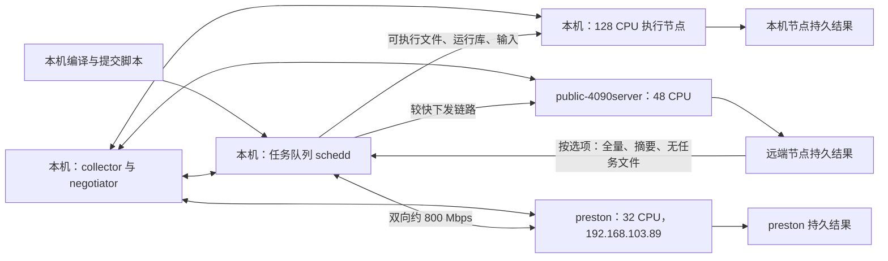

# 三节点调度与数据管理方案

> 本文保留旧 HTCondor 容器方案及历史状态。2026-11-10 新增的纯 Python + SSH 后端使用 [README.md](README.md) 中的入口；下文旧数据管理命令需显式加 `--backend condor`。旧部署脚本不属于原生入口。

本机既接任务也算任务，远端只算任务。新增或删除算力节点只编辑 [nodes.conf](nodes.conf)，再重跑部署。任务默认只搬回摘要，完整结果一直保存在执行节点，直到显式删除。

例如，节点产生 10 GB 结果时，默认只返回最多约 1 MiB 的指定摘要和两份限长日志。用户查看摘要后，再决定是否取回完整结果。`public-4090server` 的回传约需 67 分钟；新增 `preston` 双向约 100 MB/s，纯传输约需 100 秒。估算均不计压缩和协议开销。

**2026-11-10：已加入 preston 配置并实现每节点 work_dir，22 项单元测试通过。** 新节点主机与网络数据来自用户在宿主机完成的实测；本轮未执行三节点部署或端到端调度验收。此前两节点验证记录保留，状态以 [RESULTS.md](RESULTS.md) 为准。

## 1. 系统布局



三机使用同一个 Ubuntu 22.04 镜像，配置总容量为 128 + 48 + 32 = **208 CPU**，GPU 调度均关闭。HTCondor 容器采用 host 网络；本机部署 Collector、Negotiator、Schedd 和 Startd，两个远端仅部署 Startd。详情和选择依据见 [RESEARCH.md](RESEARCH.md)。

`preston` 使用 `baiyifan@192.168.103.89`，Ubuntu 22.04 LTS、Linux 6.2.0-39-generic，`nproc = 32`，无独立 GPU。SSH 用户 UID/GID 为 1017/1017，免密 sudo 可用；Docker 29.8.1 已安装且服务 active。用户实测延迟约 0.55 ms，下发约 800 Mbps，回传约 780–800 Mbps，双向高速，无 4090 节点约 21 Mbps 的回传瓶颈。

容器内创建同名、同 UID/GID 的任务账户。默认 UID/GID 为当前主控用户的 1005；脚本会检查这一点。远端宿主机 SSH 用户的 UID 不必相同。共享 UID 仅用于这套可信单用户服务。

容器不获得宿主机 Docker socket、特权模式或 cgroup 写权限。`request_cpus/memory/disk` 用于调度预留；当前没有实现每个任务的 CPU 硬限制或持久目录磁盘配额。每机预留 4096 MiB 内存给系统，CPU 数按配置发布。

## 2. 文件与职责

| 文件 | 用途 |
| --- | --- |
| `scheduler/nodes.conf` | 唯一人工维护的集群与活动节点配置 |
| `scheduler/config/Dockerfile` | 本机构建统一的 HTCondor 用户空间 |
| `scheduler/config/condor_config.*` | 公共、主控和执行节点配置模板 |
| `scheduler/scripts/deploy_cluster.py` | 预检、构建、分发、生成配置、启动、排空退役节点、检查状态 |
| `scheduler/scripts/submit_job.py` | 打包、提交、选择回传策略、可选等待完成 |
| `scheduler/scripts/job_runner.py` | 执行节点落盘、运行程序、保存日志、生成回传目录 |
| `scheduler/scripts/manage_data.py` | 列出、延后取数、显式删除持久结果 |
| `scheduler/scripts/test_cluster.sh` | 真实集群端到端测试入口 |
| `scheduler/tests/test_scheduler.py` | 无需服务的行为测试 |
| `scheduler/evidence/` | 预检、测试报告与验证记录 |
| 各节点 `work_dir` | 配置、凭据、Condor spool、任务包、持久结果；主控还保存离线渲染和取回归档 |
| `scheduler/runtime/` | 缺省本地工作目录；管理及退役节点记录始终保留在此，不入 Git |

按本次用户要求，不更新根目录的 `agents/`、`specs/` 或 `docs/`。计划、状态和逐次结果集中保存在 `scheduler/`。

## 3. 部署流程

以下命令从仓库根目录运行。主控需要 Python ≥ 3.11，远端需要 Python 3、SSH 和可用 sudo。脚本使用严格的 SSH host key 校验，不自动信任未知主机。

1. 检查 [nodes.conf](nodes.conf) 中的地址、用户、UID/GID 和 CPU 数。
2. 在有网络与 sudo 权限的宿主机终端运行预检。

```bash
python3 scheduler/scripts/deploy_cluster.py --check
```

3. 运行部署。

```bash
python3 scheduler/scripts/deploy_cluster.py
```

4. 运行端到端验证。

```bash
bash scheduler/scripts/test_cluster.sh
```

部署会检查 Docker Engine；缺失时通过宿主机 APT 安装 `docker.io`，并启用服务。已有 Docker 不替换安装来源。随后只在主控构建镜像、检查版本，再用 SSH 下发同一镜像。密码、守护进程状态和任务结果都放在专用 runtime 目录，宿主机不安装原生 HTCondor 包。

每个 `[[nodes]]` 都可以配置 `work_dir`，无需以 `/scheduler/runtime` 结尾。远端无需克隆或编译 isla-runner。

| 配置 | local 节点 | remote 节点 |
| --- | --- | --- |
| 缺省 | 仓库根目录下的 `scheduler/runtime` | SSH 用户的 `~/isla-runner/scheduler/runtime` |
| 绝对路径 | 如 `/data1/baiyifan/condor-runtime` | 如 `/home/baiyifan/condor-runtime` |
| `~/condor-runtime` | 当前主控用户的主目录下 | 对应 SSH 用户的主目录下 |
| `condor-runtime` | 相对于 isla-runner 根目录 | 相对于 SSH 登录后的当前目录，通常是 SSH 用户主目录 |

`work_dir` 优先于兼容别名 `remote_runtime`；未配置两个字段时才使用缺省值。不展开 `$HOME` 等 shell 变量。路径必须指向专用目录，拒绝空值、`..`、`~user`、控制字符、卷分隔符 `:`、根目录、用户主目录和危险系统目录；解析符号链接后还会检查一次。local 在加载时检查实际路径，remote 在连接目标节点解析时检查。

部署在各节点的 `<work_dir>` 下创建 `config/`、`auth/`、`condor/`、`data/`、`submissions/`，分别挂载到容器固定位置；例如 `<work_dir>/data:/srv/isla` 和 `<work_dir>/submissions:/srv/submit`。提交任务包、离线渲染与取回归档也使用主控的 `work_dir`。部署和退役节点登记仍固定在仓库内 `scheduler/runtime/`，更改工作目录不会绕过旧服务的数据迁移检查。

`nodes.conf` 的候选 25.x 包源尚未联网核实。构建失败会在改变现有 HTCondor 服务前停止。Docker 安装和启用属于宿主机变更；部署不是跨节点的原子事务。部分节点启动失败时应保留证据、修复后重跑。

相同配置和镜像的运行容器会保持运行。配置有变化时，脚本先用 `condor_off -peaceful -master` 等待旧任务结束，再重建容器。默认等待 180 秒；超时会报告仍在排空，不强杀任务。

```bash
python3 scheduler/scripts/deploy_cluster.py --timeout 3600
python3 scheduler/scripts/deploy_cluster.py --status-only
```

无服务时，可以检查离线产物：

```bash
python3 scheduler/scripts/deploy_cluster.py --render-only
python3 -m unittest discover -s scheduler/tests -v
```

这些命令不能验证真实 Condor 语法、权限或网络。

### 网络与首次安装

三机应允许对端访问 TCP 9618 和 9700–9799。主控还应能 SSH 到两个远端。脚本保留已有防火墙策略；按所在环境的管理方式放行上述端口。包源与 Docker 镜像下载也必须可达。

首次构建将下载 Ubuntu 基础镜像、HTCondor 及依赖。后续下发镜像使用较快的本机到远端链路。同一镜像已存在时不重复传输；新任务的输入目前仍逐任务打包，没有引入共享输入缓存。

## 4. 只编辑一个配置文件增减节点

新增节点时，在 `nodes.conf` 添加一个 `[[nodes]]`：

```toml
[[nodes]]
name = "new-worker"
address = "192.168.221.162"
local = false
ssh_user = "baiyifan"
cpus = 32
hardware_gpus = 0
enable_gpus = false
work_dir = "~/isla-runner/scheduler/runtime"
```

地址和规格只是扩展示例。准备好 SSH known_hosts、免密 sudo、系统和网络后，重跑部署及测试。模板、hosts、认证文件和资源广告均由脚本生成，不要求手改多份配置。

删除节点时，删除其 `[[nodes]]`，然后重跑部署。脚本根据已管理节点记录连接该节点，等待任务结束，再删除服务容器。部分部署中已启动的节点也有记录，不必等待整批验收成功。结果目录、镜像与取数所需的退役记录保留。它不会把旧队列中的节点定向任务自动改投其他节点。

节点必须仍可达，才能确认服务已退出。若 SSH 不通，脚本会停止并保留部署记录，不把节点记为已成功退役。离线硬件的处置须由管理员先核实任务状态。

主控、集群名、容器名、UID/GID 和 UID domain 不是普通算力节点字段。已有集群不允许直接替换这些基础字段；它们涉及现有队列和文件所有权，需要单独迁移。同一节点的 SSH 用户和 runtime 路径也须先单独迁移。

## 5. 提交任务

先用简单命令验证提交与二进制分发：

```bash
python3 scheduler/scripts/submit_job.py \
  --executable /usr/bin/getconf --bundle-libs \
  --summary-only --node public-4090server --wait \
  -- GNU_LIBC_VERSION
```

`--` 后的参数原样作为 argv 传给任务，不通过 shell。若需要 shell 命令，应显式提交脚本。CLI 输出 JSON，包含本地目录、内部 job ID 和 Condor cluster ID。

任务约定如下：

- `--executable` 指定可执行文件，复制后保留文件名，放在任务 `bin/` 中。
- 每个 `--input` 放到 `inputs/<basename>`，支持普通文件和目录；拒绝 basename 冲突与符号链接。
- 工作目录已有 `results/`。应用应把需要管理的结果写在工作目录内。
- `--summary` 指定需要回传的相对文件，可重复使用；默认为 `results/summary.json`。
- `--env NAME=VALUE` 显式传环境变量，不继承整套主控环境。
- `--cpus`、`--memory`、`--disk`、`--gpus` 声明资源。默认是 1 CPU、1 GB 内存、2 GB 磁盘、0 GPU。
- `--bundle-libs` 可打包普通 ELF 的启动依赖；适用限制见调研文档。
- `--dry-run` 生成包和 submit 文件，不连接 Condor。

以端到端测试生成的示例程序为例：

```bash
python3 scheduler/scripts/submit_job.py \
  --executable scheduler/runtime/test-inputs/task.py \
  --input scheduler/runtime/test-inputs/input.txt \
  --node public-4090server --summary-only --wait
```

该示例文件由 `test_cluster.sh` 生成。真实 Isla 任务应提供当前模型、配置和程序需要的全部数据，并把程序的输出参数指向 `results/`。调度器不改变模型、IR 或 `--check-samples` / judge 的语义确认流程。

### 三种回传选项

| 选项 | 回传到提交节点 | 执行节点保留 |
| --- | --- | --- |
| `--summary-only`，默认 | 执行状态、指定摘要文件、stdout/stderr 尾部 | 完整工作目录和完整日志 |
| `--retrieve-data` | 同上，加 `full.tar.gz`，包含整个工作目录 | 同上 |
| `--no-retrieve` | 无任务文件；队列事件和退出状态仍可查询 | 同上 |

指定摘要文件合计上限为 1 MiB，单份日志尾部上限为 64 KiB；两者在 `nodes.conf` 中配置。超限、缺失或指向工作目录外的摘要不会复制，名称进入 `omitted_summaries`。元数据另占少量空间，因此摘要模式总大小不是严格等于 1 MiB。

完整回传额外占用节点压缩空间、Condor scratch 和主控落地空间，并可能延长任务完成时间。压缩收益取决于数据内容；随机数据不保证缩小。不应给所有任务默认打开全量回传。

stdout/stderr 在运行时写到节点文件，不持续流式传回。`--no-retrieve` 使用空输出文件列表和 `/dev/null`，避免 stdout/stderr 被 Condor 单独自动取回。

## 6. 数据生命周期

每个提交生成一个内部 job ID。执行时先把输入复制到持久目录，然后在其中启动程序：

```text
节点 <work_dir>/data/jobs/<job-id>/
  attempt-<uuid>/
    summary.json
    work/
      manifest.json
      bin/
      inputs/
      runtime-libs/          # 可选
      results/
      stdout.log
      stderr.log
```

容器内对应位置为 `/srv/isla/jobs/`。Condor scratch 仅负责文件传输；它被清理后，持久目录仍在。自动重调度会创建新的 attempt，保留旧 attempt，避免覆盖历史结果。应用若写外部服务等副作用，仍需自行保证可重跑。

主控每次提交的 `<work_dir>/submissions/<job-id>/` 保存包、submit 文件、事件、可选回传目录，以及使用 `--wait` 时取得的 history。传输失败后可以直接从节点取数，不必为了取回已有结果重算任务。

```bash
python3 scheduler/scripts/manage_data.py --node public-4090server list
python3 scheduler/scripts/manage_data.py --node public-4090server --job-id JOB_ID summary
python3 scheduler/scripts/manage_data.py --node public-4090server --job-id JOB_ID fetch
```

`JOB_ID` 替换为实际 32 位内部 ID。`summary` 只取状态、限长日志和配置指定的摘要；`fetch` 取该任务全部 attempt。归档放在主控 `<work_dir>/retrieved/`。短命取数容器不接入调度网络；退役节点仍可按自动保存的记录取数。

归档默认不自动解包。完整结果可能包含用户程序创建的符号链接，解包前应查看归档内容。这里只传输用户明确选取的任务，不扫描或搬回整个节点数据盘。

没有自动清理期限。检查任务已完成并确认不再需要节点数据后，显式删除：

```bash
python3 scheduler/scripts/manage_data.py --node public-4090server --job-id JOB_ID delete
```

删除前脚本检查主控队列，拒绝删除仍在队列中的任务，也拒绝存在无完成摘要的 attempt。异常中断目录须先人工核实。主控的提交副本不会被这条命令删除。

节点掉电、磁盘损坏或手工删除仍会丢失仅存节点的数据。是否完整回传是用户对带宽和数据保留的选择；本方案没有把单节点保留当作备份。

## 7. 验证与异常处理

真实验收脚本先检查每机 partitionable slot 的 `TotalSlotCpus`，然后在每个节点分别执行三种策略，当前三节点共九个任务。每个任务读取下发输入，生成 2 MiB 不易压缩的数据和小摘要。脚本检查退出码、执行主机、完整归档、摘要大小，以及节点上保留的数据。

证据写到 `scheduler/evidence/e2e-*.json`。仅在所有任务和最终节点检查都通过时写 PASS。预检失败、Held、超时或数据不符会退出非零；通过本地单元测试不计入集群 PASS。

常用诊断命令：

```bash
sudo docker exec isla-condor condor_status
sudo docker exec -u 1005:1005 isla-condor condor_q
sudo docker exec -u 1005:1005 isla-condor condor_q -better-analyze
sudo docker exec isla-condor condor_config_val SEC_DEFAULT_AUTHENTICATION_METHODS
sudo docker logs isla-condor
```

如果配置 UID 不同，替换命令中的 UID/GID。守护进程详细日志位于各节点 `<work_dir>/condor/log/`。

`--wait` 检测到 Held 会报告 HoldReason；等待超时不会取消任务。排查或取消时使用返回的 Condor cluster ID，例如：

```bash
sudo docker exec -u 1005:1005 isla-condor condor_rm CLUSTER_ID
```

普通程序非零退出不会被包装成成功，也不会自动反复提交。包装器自身错误返回 125。节点中断可能只有部分持久文件；需根据 attempt 状态和队列判断恢复方式。

## 8. 后续验收顺序

1. 在无会话沙箱限制的终端完成预检，复核远端系统、CPU 和 sudo。
2. 核实官方包源、签名密钥和所选系列的维护状态。
3. 构建并部署，检查版本、有效安全配置、监听端口和三节点共 208 CPU 广告。
4. 运行九任务端到端验收。
5. 增补错误凭据不能注册、低权限用户不能管理服务的认证负例。
6. 用实际 Isla 可执行文件、模型和小任务验证运行库与数据目录。
7. 按需测试节点增删排空、服务重启、断线和任务恢复。
8. 需要 GPU 时再启用 NVIDIA runtime，并单独验收 GPU 发现与任务。

用户已提供 preston 的主机与网络实测；其余真实集群验收仍须单独完成。吞吐、大并发文件传输、磁盘配额、多用户隔离和高可用不在本轮单元测试结论内。
